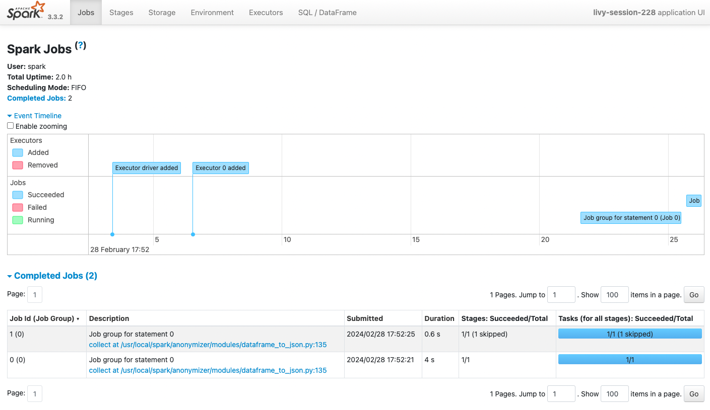
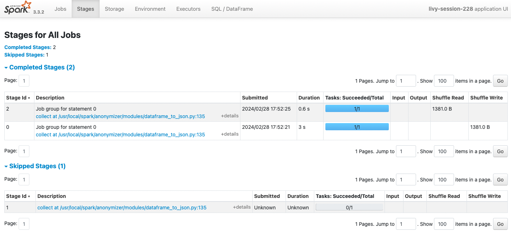

## Spark 작업은 어떻게 나뉠까?

Spark UI를 열면 같은 코드에서도 Job과 Stage, Task가 따로 표시된다. 이름이 비슷하지만 각각 확인하는 범위가 다르다.

| 실행 단위 | 의미 |
|---|---|
| Job | 액션으로 결과를 얻거나 저장하기 위해 실행하는 작업 |
| Stage | 셔플 경계 등으로 나뉜 Job의 실행 단계 |
| Task | 한 Stage에서 파티션 하나를 처리하는 작업 |

파티션은 나누어 둔 데이터이고 Task는 그 데이터를 처리하는 작업이다. 파티션 두 개를 읽는 Stage라면 보통 Task 두 개가 만들어진다. 이 Task가 동시에 실행되는지는 사용 가능한 실행 슬롯에 따라 달라진다.

## Driver와 Executor의 역할

Driver는 실행 계획을 만들고 작업을 스케줄링한다. Executor는 배정받은 Task를 실행하고 데이터를 저장하거나 셔플 데이터를 주고받는 프로세스이다.



애플리케이션 사이의 자원을 배정하는 클러스터 매니저와 애플리케이션 안의 Task를 배정하는 스케줄러는 구분해야 한다. DAG 스케줄러가 Job을 Stage로 나누고 Task 스케줄러가 실행 가능한 Task를 Executor에 배정한다.

## 주문 금액 합산 예제

고객별 주문 금액에 10% 할인을 적용한 뒤 합산해보려고 한다. 실행 단계를 확인하기 위해 간단한 RDD 예제를 사용한다.

```python
from pyspark.sql import SparkSession

spark = SparkSession.builder.master("local[2]").appName("stage-example").getOrCreate()
sc = spark.sparkContext

orders = sc.parallelize(
    [("A", 100), ("B", 50), ("A", 30)],
    2,
)
discounted = orders.mapValues(lambda amount: amount * 0.9)
totals = discounted.reduceByKey(lambda left, right: left + right, numPartitions=2)

print(sorted(totals.collect()))
# [('A', 117.0), ('B', 45.0)]
```

`parallelize()`에서 입력 파티션을 두 개로 만들었다. `mapValues()`와 `reduceByKey()`는 변환을 정의하고 `collect()`가 결과를 요청하는 액션이다.

### Job은 언제 시작할까?

Spark는 변환을 정의할 때마다 전체 데이터를 즉시 계산하지 않는다. 결과가 필요한 액션을 만나면 관련 변환을 실행한다. 이를 지연 실행이라고 한다.

위 예제에서는 `collect()`를 호출할 때 합산 결과를 얻기 위한 Job이 실행된다. 다만 SQL이나 DataFrame 작업에서는 내부 연산 때문에 액션 하나가 여러 Job으로 보일 수도 있다. 모든 코드에서 “액션 하나 = UI의 Job 하나”라고 단정하지 않는다.

### Stage는 어디에서 나뉠까?

`mapValues()`는 각 파티션의 데이터만으로 계산할 수 있다. 반면 고객 A의 금액을 합치려면 서로 다른 파티션에 있는 A의 주문을 같은 쪽으로 모아야 한다. 이 데이터 재분배가 셔플이다.



이 예제의 실행은 크게 두 단계로 나눌 수 있다.

1. 각 입력 파티션에서 할인 금액을 계산하고 셔플 데이터를 만든다.
2. 셔플에서 같은 키의 데이터를 모아 최종 합계를 계산한다.

셔플 전 Stage가 필요한 출력을 준비하면 의존하는 Stage가 그 데이터를 읽어 실행한다. 서로 의존하지 않는 Stage까지 항상 하나씩 순서대로만 실행되는 것은 아니다.

### Task는 몇 개 실행할까?

첫 Stage는 입력 파티션 두 개를 처리하므로 Task 두 개가 필요하다. 합산 결과의 파티션도 두 개로 지정했으므로 다음 Stage에도 Task 두 개가 필요하다. 실패와 재시도 등을 제외한 기본 실행 기준이다.

Task가 네 개라고 네 개의 Executor가 필요한 것은 아니다. Executor 하나에서도 여러 Task를 실행할 수 있다. 위 로컬 예제는 `local[2]`이므로 동시에 실행할 수 있는 작업 슬롯이 두 개이다.

## Spark UI에서 확인할 것

실행 중에는 기본적으로 `http://localhost:4040`에서 UI를 열 수 있다. 다른 애플리케이션이 포트를 쓰고 있거나 원격 환경이면 주소가 달라질 수 있다.

Stage별로 Task 수와 처리 시간, 입력량과 셔플 읽기·쓰기량을 확인한다. 특정 Task만 오래 걸리면 그 파티션에 데이터가 몰렸는지 확인하고 모든 Task가 느리다면 전체 입력량과 I/O, 실행 자원을 함께 본다.

DataFrame과 SQL에서는 `explain()`으로 실행 계획도 확인할 수 있다. AQE가 활성화되어 있으면 실행 중 통계에 따라 셔플 파티션 수 등이 조정될 수 있으므로 처음 지정한 숫자와 UI의 Task 수가 항상 같지는 않다.

## 마무리

Job은 결과를 요청한 작업이고 Stage는 데이터를 처리하는 단계이며 Task는 파티션 하나를 처리하는 실행 단위이다. Task 수를 늘리기 전에 어느 Stage에서 셔플이 발생하고 데이터가 어떻게 나뉘는지 확인하는 것이 먼저다.

## 참고자료

- [Spark RDD 연산과 셔플](https://spark.apache.org/docs/3.5.6/rdd-programming-guide.html)
- [Spark 클러스터 구성 요소](https://spark.apache.org/docs/3.5.6/cluster-overview.html)
- [Spark 작업 스케줄링](https://spark.apache.org/docs/3.5.6/job-scheduling.html)
- [Spark SQL AQE](https://spark.apache.org/docs/3.5.6/sql-performance-tuning.html#adaptive-query-execution)
