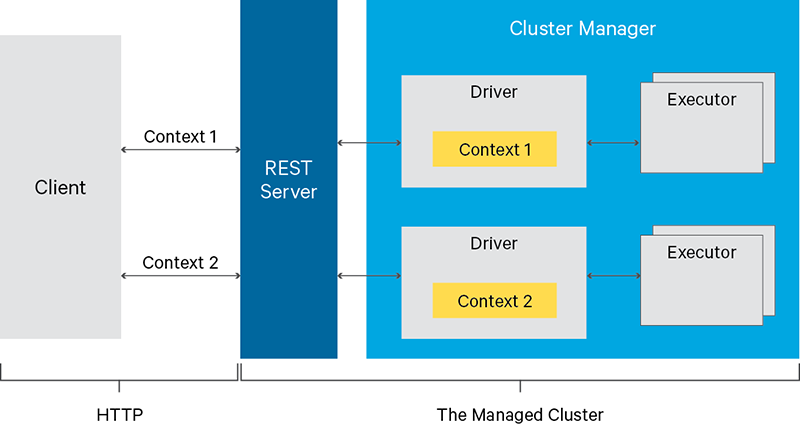
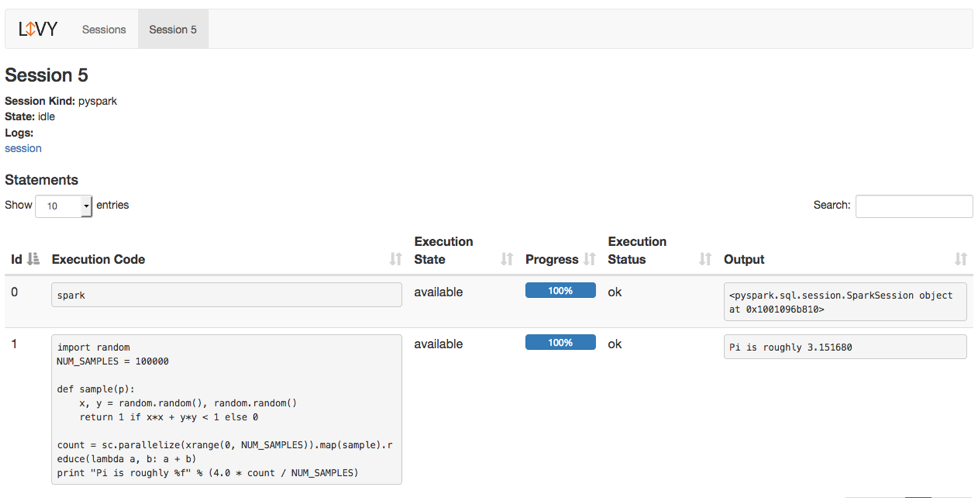
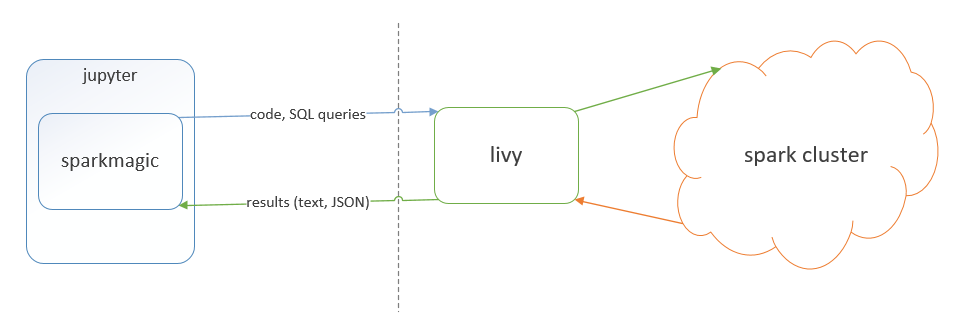
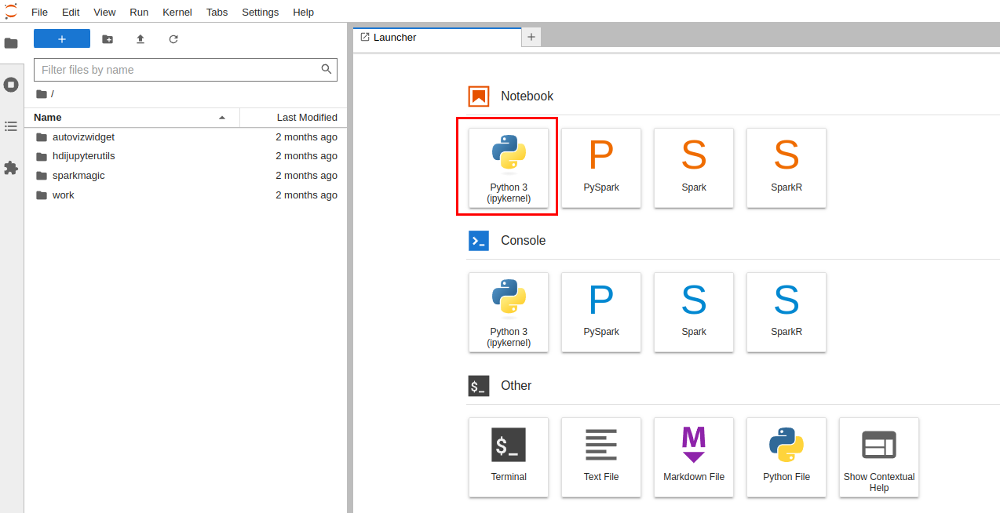
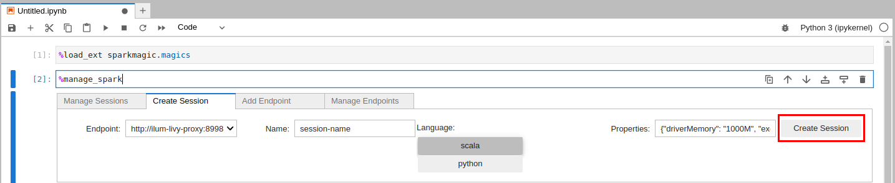
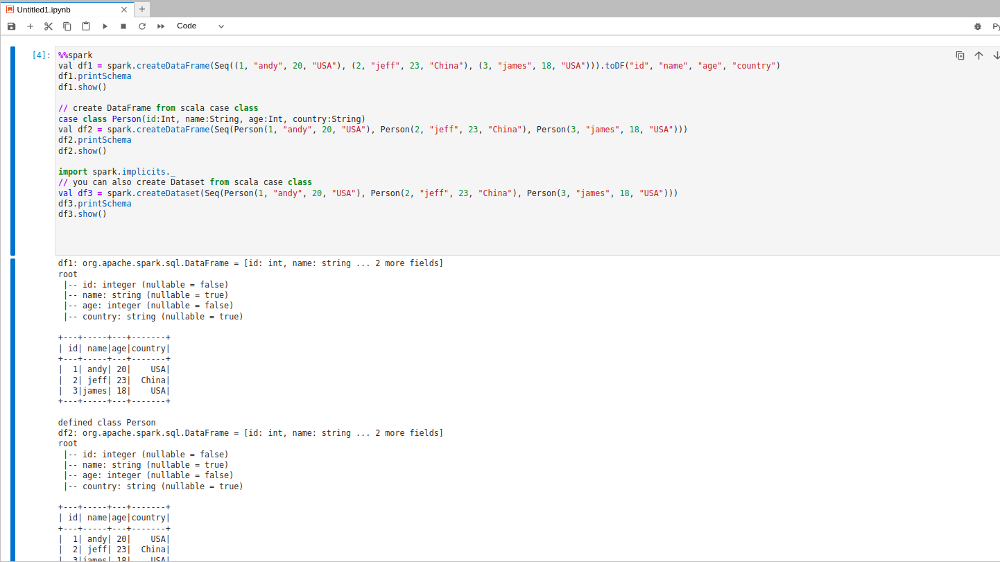
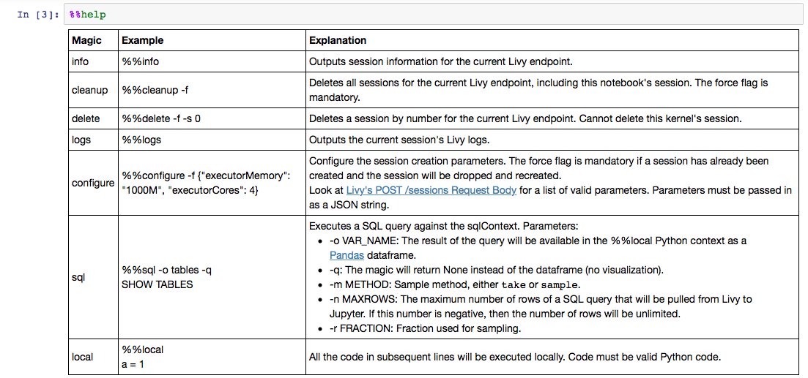
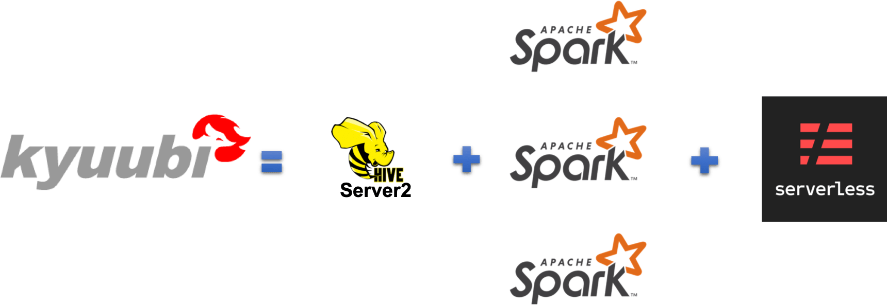
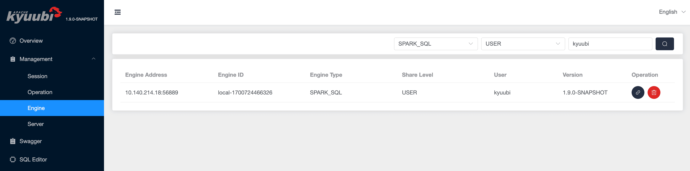
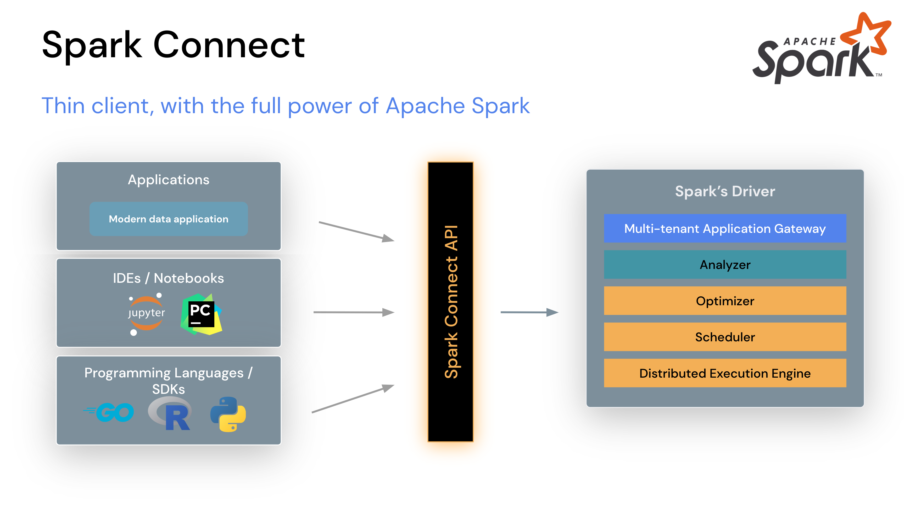

## Spark를 원격으로 사용하려면

애플리케이션이나 노트북에서 Spark를 사용하려면 코드를 어디로 제출하고 실행 결과를 어떻게 받을지 정해야 한다. Livy와 Sparkmagic, Kyuubi, Spark Connect는 이 연결을 돕지만 모두 같은 종류의 도구는 아니다.

| 도구 | 주로 연결하는 클라이언트 | 역할 |
|---|---|---|
| Livy | REST API를 호출하는 애플리케이션 | 대화형 세션과 배치 작업 제출·조회 |
| Sparkmagic | Jupyter 노트북 | Livy에 코드를 보내는 커널과 매직 명령 |
| Kyuubi | JDBC·ODBC·REST 클라이언트 | SQL 게이트웨이와 엔진 관리 |
| Spark Connect | DataFrame API를 사용하는 프로그램 | 논리 실행 계획을 서버로 전달 |

특히 Sparkmagic은 Livy를 대체하는 서버가 아니라 Livy에 연결하는 클라이언트 도구이다. 세션을 제공한다는 것과 사용자별 자원이 완전히 격리된다는 것도 구분해야 한다.

## Livy: REST API로 코드 제출

Livy는 Spark 코드를 원격으로 실행하는 REST 서비스를 제공한다. 대화형 세션을 만들면 같은 실행 환경에서 코드를 여러 번 제출할 수 있다.



### 코드 제출 흐름

1. `POST /sessions`에서 `kind=pyspark` 세션을 만든다.
2. 응답의 세션 ID로 `GET /sessions/{id}`를 조회해 `idle` 상태를 기다린다.
3. `POST /sessions/{id}/statements`에 Python 코드를 보낸다.
4. statement ID로 완료 상태와 출력을 조회한다.

아래는 제출할 코드의 예시이다. Livy의 `pyspark` 세션에 보내는 `code` 필드에 넣는다.

```python
NUM_SAMPLES = 100000
count = sc.parallelize(range(NUM_SAMPLES)).map(lambda x: x * 2).count()
print(count)
```

클라이언트에서 `requests`를 사용한다면 HTTP 오류와 타임아웃, 세션의 실패 상태를 함께 처리한다. 전체 흐름은 [Livy REST API로 Spark 작업 실행하기](/data/[Data]-Apache-Livy로-Spark-사용하기/)에 정리했다.



세션별로 Spark 애플리케이션을 실행할 수 있지만 인증과 사용자 위임, 큐와 자원 제한까지 자동으로 구성되는 것은 아니다.

## Sparkmagic: Jupyter에서 Livy에 연결

Sparkmagic은 Jupyter에서 Livy를 통해 원격 Spark를 사용하는 도구이다. 노트북 쪽에는 커널과 연결 설정이 필요하고 Spark 계산은 원격 실행 환경에서 처리한다.



노트북 서버에 Spark 전체 실행 환경을 두지 않아도 되지만 Python 패키지와 인증 정보, Livy 주소는 준비해야 한다. 노트북에서 사용하는 로컬 Python 변수와 원격 Spark 세션의 변수도 같은 메모리에 있는 것이 아니다.

### 노트북 사용 흐름

Sparkmagic 커널을 선택하거나 제공되는 확장을 불러온다.



Livy 연결과 세션을 등록한다.



등록한 세션으로 Spark 코드를 실행한다.



SQL 실행과 세션 설정 같은 작업에는 매직 명령을 사용할 수 있다.



Pandas나 시각화 도구를 사용하려고 원격 결과 전체를 노트북으로 가져오면 노트북 프로세스의 메모리가 부족해질 수 있다. 로컬로 가져올 결과의 크기는 별도로 제한해야 한다.

## Kyuubi: SQL 게이트웨이와 엔진 관리

Kyuubi는 JDBC·ODBC 등으로 접속해 SQL을 실행할 수 있는 분산 SQL 게이트웨이이다. Spark SQL 엔진을 사용하면서 클라이언트 세션과 엔진의 생명주기 등을 관리할 수 있다.



BI 도구처럼 SQL 인터페이스가 필요한 클라이언트에 연결할 수 있고 REST API로 세션과 작업을 관리할 수도 있다. 엔진 공유 수준에 따라 여러 세션이 같은 엔진을 사용할 수 있으므로 세션 하나가 항상 전용 Spark 애플리케이션 하나를 뜻하지는 않는다.

### REST API 예시

다음은 Kyuubi 1.9.2 REST API 문서의 요청 형식을 기준으로 한다. 포트와 인증 설정은 자신의 서버에 맞춘다. 기본 경로인 `/api/v1`과 요청 필드 이름을 Livy와 구분해야 한다.

```python
import requests

base_url = "http://localhost:10099/api/v1"

response = requests.post(
    f"{base_url}/sessions",
    json={"configs": {"spark.app.name": "rest-example"}},
    timeout=(5, 30),
)
response.raise_for_status()
session_id = response.json()["identifier"]

response = requests.post(
    f"{base_url}/sessions/{session_id}/operations/statement",
    json={"statement": "SELECT 1", "runAsync": True},
    timeout=(5, 30),
)
response.raise_for_status()
operation_id = response.json()["identifier"]

response = requests.get(
    f"{base_url}/operations/{operation_id}/event",
    timeout=(5, 30),
)
response.raise_for_status()
print(response.json())
```

여기서는 작업을 제출하고 상태를 한 번 조회했다. `runAsync=true`이므로 아직 완료되지 않았을 수 있다. 주기적으로 완료 여부를 확인한 뒤 결과 조회 API를 사용하고 더 이상 필요 없는 operation과 세션은 닫는다.

로드 밸런서 뒤에 여러 Kyuubi 인스턴스가 있다면 세션 생성 응답의 `kyuubiInstance`와 세션 라우팅도 확인해야 한다.



## Spark Connect: DataFrame API로 원격 연결

Spark Connect는 Spark 3.4에서 도입된 클라이언트·서버 구조이다. 클라이언트가 DataFrame 연산의 논리 계획을 보내면 서버에서 Spark 작업으로 실행하고 결과를 돌려준다.



Spark 3.5 계열에서는 Python과 Scala 클라이언트를 사용할 수 있다. 지원 API는 일반 Spark 클라이언트와 다르며 `SparkContext`나 RDD API를 그대로 사용할 수는 없다.

### 연결 예시

아래 명령은 Spark 3.5.6과 Scala 2.12 배포판을 기준으로 한다. `SPARK_HOME`은 해당 Spark 설치 경로이고 패키지 버전도 서버 배포판과 맞춘다.

```bash
"$SPARK_HOME/sbin/start-connect-server.sh" \
  --packages org.apache.spark:spark-connect_2.12:3.5.6
```

클라이언트에는 같은 버전의 `pyspark[connect]`와 필요한 의존성을 준비한다. 서버를 실행한 호스트에 연결하는 예시이다.

```python
from pyspark.sql import SparkSession

spark = SparkSession.builder.remote("sc://localhost:15002").getOrCreate()
df = spark.createDataFrame([(1, "A"), (2, "B")], ["id", "name"])
df.show()
spark.stop()
```

다른 컴퓨터에서 접속하면 `localhost`를 서버 주소로 바꾸어야 한다. 세션이 분리되어도 서버 자원과 권한이 모두 격리되는 것은 아니므로 여러 사용자에게 제공할 때는 인증과 접근 제어, 자원 제한을 따로 설계한다.

## 마무리

애플리케이션에서 코드 제출을 REST로 묶으려면 Livy를 검토할 수 있고 Jupyter에서 Livy를 쓰려면 Sparkmagic이 연결을 돕는다. SQL 클라이언트를 연결하고 엔진을 관리하려면 Kyuubi가 맞는지 확인한다. DataFrame 코드를 원격으로 실행하려면 Spark Connect의 지원 API를 확인하면 된다.

도구 이름보다 클라이언트가 어떤 인터페이스를 필요로 하는지와 세션·엔진을 어느 단위로 공유할지부터 정하는 것이 중요하다.

## 참고자료

- [Apache Livy REST API](https://livy.apache.org/docs/latest/rest-api.html)
- [Sparkmagic 공식 저장소](https://github.com/jupyter-incubator/sparkmagic)
- [Kyuubi REST API v1](https://kyuubi.readthedocs.io/en/v1.9.2/client/rest/rest_api.html)
- [Kyuubi 엔진 공유 수준](https://kyuubi.readthedocs.io/en/v1.9.2/deployment/engine_share_level.html)
- [Spark Connect 개요](https://spark.apache.org/docs/3.5.6/spark-connect-overview.html)
- [Spark Connect 시작하기](https://spark.apache.org/docs/3.5.6/api/python/getting_started/quickstart_connect.html)
