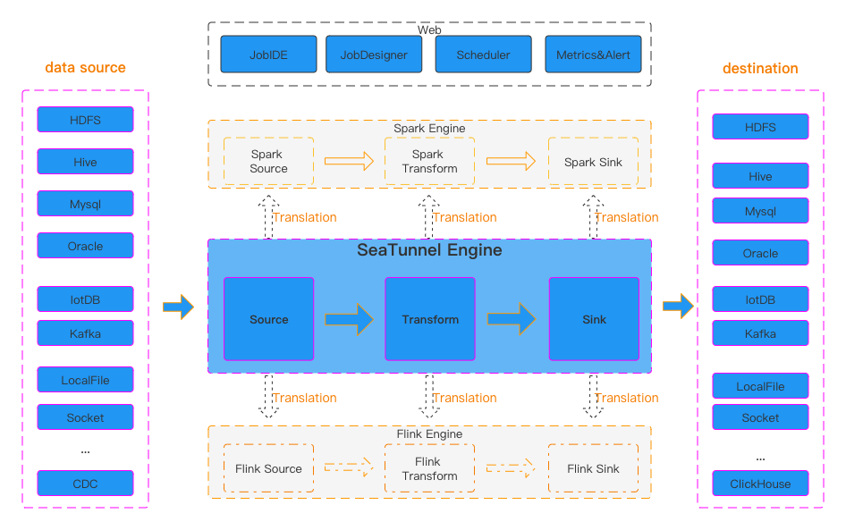
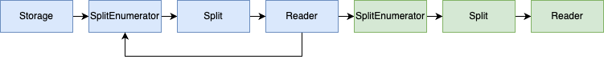
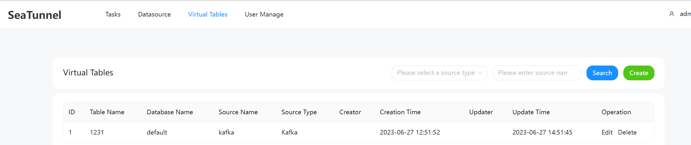
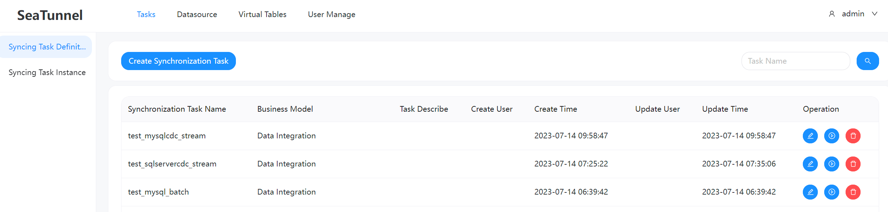
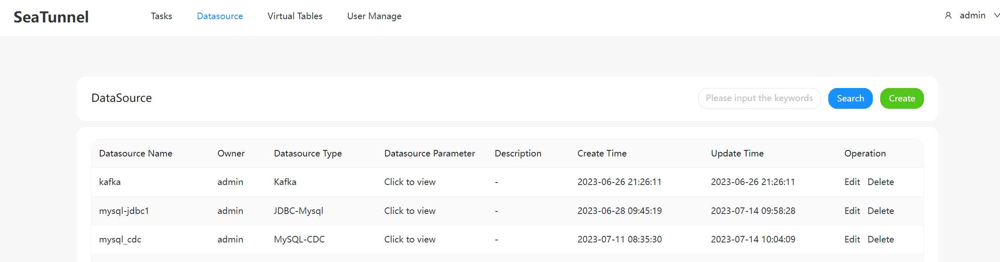
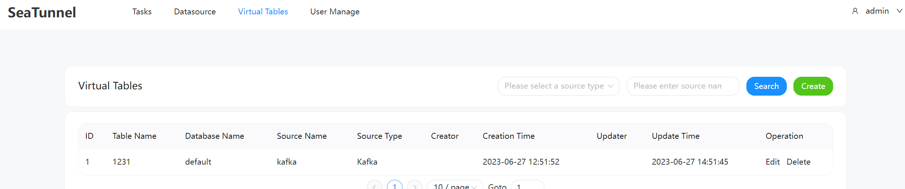
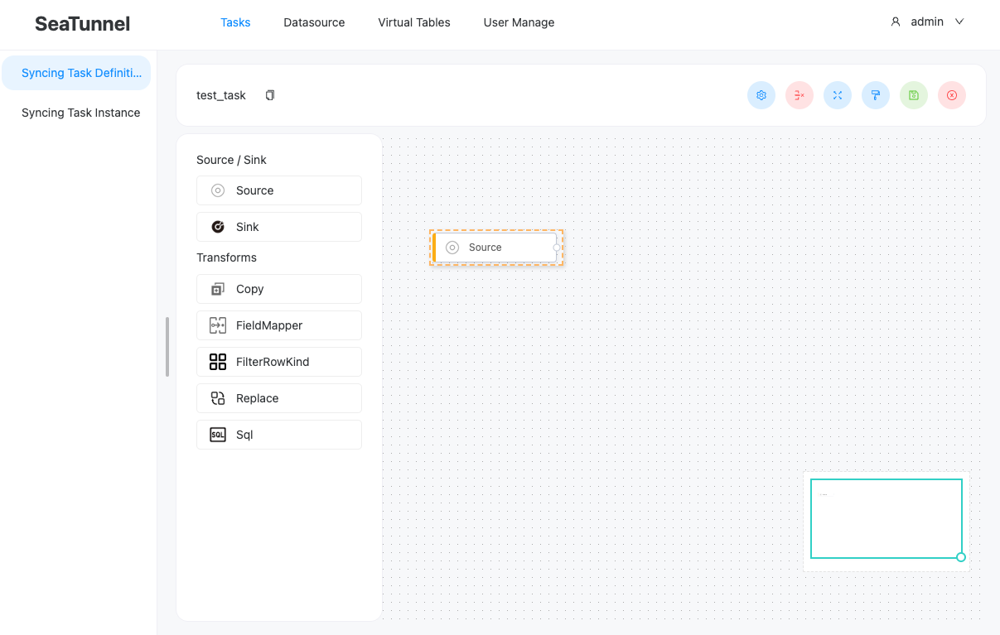
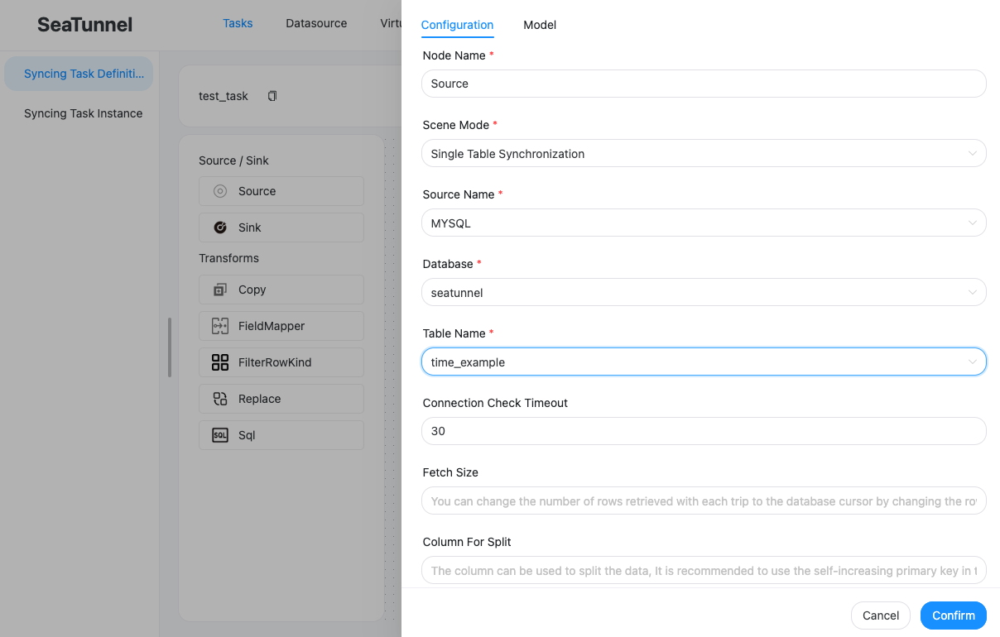
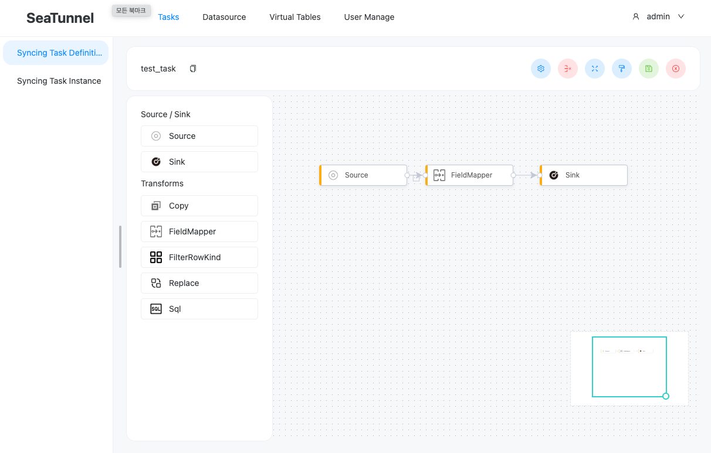

## Apache SeaTunnel

DB의 데이터를 다른 저장소로 옮길 때 소스에 연결하고 값을 변환한 뒤 대상에 쓰는 작업이 필요하다. SeaTunnel은 이 과정을 Source와 Transform, Sink로 구성하는 데이터 통합 도구이다.

자체 실행 엔진인 Zeta와 다른 엔진을 사용하는 구성이 있지만 모든 Connector가 모든 엔진을 지원하는 것은 아니다. 예를 들어 2.3.5의 MySQL CDC Connector는 Zeta와 Flink 지원 여부를 문서에서 확인할 수 있다.



## CDC는 두 단계로 나누어 보기

기존 테이블을 복제하려면 현재 데이터 전체와 이후 변경을 모두 가져와야 한다. 일반적인 초기 CDC 흐름은 스냅샷을 읽은 뒤 변경 로그를 이어 읽는 방식이다. 설정에 따라 스냅샷 없이 변경부터 읽는 구성도 있으므로 시작 모드를 함께 확인한다.

### 초기 스냅샷



큰 테이블을 여러 범위로 나누고 Reader가 각 범위를 읽는다. 예를 들어 100만 행을 10만 행씩 열 구간으로 나누어 Reader 네 개에 할당할 수 있다. 앞선 구간을 마치면 다음 구간을 읽는다.

Reader가 네 개라는 것은 예제의 병렬도 설정이다. CPU가 4코어라는 이유로 자동으로 Reader 네 개가 만들어지는 것은 아니다. 테이블 크기와 분할 기준, DB가 감당할 수 있는 동시 조회 수를 함께 고려해야 한다.

스냅샷을 읽는 동안 원본 데이터가 바뀔 수도 있다. 따라서 단순히 SELECT 결과를 합치는 것만으로는 일관성이 맞지 않을 수 있다. Connector는 스냅샷과 변경 로그를 연결할 위치를 추적해 초기 데이터와 이후 변경을 이어 처리한다.

락 사용 여부도 DB와 Connector의 스냅샷 방식에 따라 다르다. SeaTunnel은 언제나 무잠금이고 Debezium은 언제나 테이블을 잠근다는 식으로 구분할 수는 없다.

### 증분 변경 처리


스냅샷 이후에는 MySQL의 binlog나 PostgreSQL의 WAL 같은 변경 로그를 따라간다. 이때 행의 값뿐 아니라 삽입·수정·삭제 중 어떤 변경인지도 대상에 전달해야 한다.

증분 구간의 병렬성은 Connector와 원본 로그의 구조에 따라 다르다. 로그를 읽는 작업과 이후 변환·쓰기 작업까지 모두 항상 단일 스레드로 실행된다고 볼 수는 없다.

### Sink까지 변경 의미를 유지하기

원본에서 삭제 이벤트를 받아도 Sink가 추가 쓰기만 지원한다면 대상의 행이 자동으로 삭제되지는 않는다. Source와 Transform이 전달한 변경 유형을 Sink가 어떻게 적용하는지 확인해야 한다.

기본 키를 사용한 upsert와 삭제를 적용한다면 변환 중 기본 키를 없애지 않도록 주의한다. 화면에 값이 들어왔는지만 확인하지 말고 같은 행을 수정하고 삭제한 결과까지 비교해야 한다.

## 장애가 나면 어디에서 다시 시작할까?

체크포인트는 읽은 로그 위치와 작업 상태 등을 남겨 복구할 때 사용하는 기준이다. 실패 시 모든 데이터를 처음부터 읽지 않고 저장한 상태에서 다시 시작하도록 돕는다.

그렇다고 체크포인트만 켜면 어떤 Sink에서도 중복이 사라지는 것은 아니다. 읽기 위치 복구와 대상 시스템의 커밋 방식이 맞아야 한다. 사용하는 Source·Sink와 엔진의 지원 범위를 함께 확인해야 한다.

## 데이터 변환 예제

아래 세 가지는 각각 독립적인 Transform 설정의 일부이다. 전체 CDC 실행 설정은 아니며 Source와 Sink는 별도로 필요하다. 옵션 이름은 SeaTunnel 2.3.5 문서를 기준으로 한다.

### FieldMapper

FieldMapper는 남길 필드와 순서, 이름을 매핑한다. 아래는 `age`를 제외하고 `name`을 `new_name`으로 바꾸는 예제이다. 타입 변환을 수행하는 설정은 아니므로 타입을 바꾸려면 SQL 변환 등 지원 기능을 따로 사용한다.

```hocon
transform {
  FieldMapper {
    source_table_name = "fake"
    result_table_name = "fake1"
    field_mapper = {
        id = id
        card = card
        name = new_name
    }
  }
}

```

입력 데이터

| id | name     | age | card |
|----|----------|-----|------|
| 1  | Joy Ding | 20  | 123  |
| 2  | May Ding | 20  | 123  |
| 3  | Kin Dom  | 20  | 123  |
| 4  | Joy Dom  | 20  | 123  |

출력 데이터

| id | card | new_name |
|----|------|----------|
| 1  | 123  | Joy Ding |
| 2  | 123  | May Ding |
| 3  | 123  | Kin Dom  |
| 4  | 123  | Joy Dom  |

### Replace

Replace는 데이터 값의 치환 작업을 수행한다.
특정 필드의 값을 다른 값으로 대체하거나 패턴을 기반으로 값을 변환할 때 사용한다.

```hocon
transform {
  Replace {
    source_table_name = "fake"
    result_table_name = "fake1"
    replace_field = "name"
    pattern = " "
    replacement = "_"
    is_regex = true
  }
}
```

입력 데이터

| name     | age | card |
|----------|-----|------|
| Joy Ding | 20  | 123  |
| May Ding | 20  | 123  |
| Kin Dom  | 20  | 123  |
| Joy Dom  | 20  | 123  |

출력 데이터

| name     | age | card |
|----------|-----|------|
| Joy_Ding | 20  | 123  |
| May_Ding | 20  | 123  |
| Kin_Dom  | 20  | 123  |
| Joy_Dom  | 20  | 123  |

### Split

Split은 문자열 필드를 구분자를 기준으로 여러 개의 필드로 분할하는 작업을 수행한다.
하나의 문자열 필드를 여러 개의 필드로 나눠야 할 때 사용된다.

```hocon
transform {
  Split {
    source_table_name = "fake"
    result_table_name = "fake1"
    separator = " "
    split_field = "name"
    output_fields = [first_name, last_name]
  }
}
```

입력 데이터

| name     | age | card |
|----------|-----|------|
| Joy Ding | 20  | 123  |
| May Ding | 20  | 123  |
| Kin Dom  | 20  | 123  |
| Joy Dom  | 20  | 123  |

출력 데이터

| name     | age | card | first_name | last_name |
|----------|-----|------|------------|-----------|
| Joy Ding | 20  | 123  | Joy        | Ding      |
| May Ding | 20  | 123  | May        | Ding      |
| Kin Dom  | 20  | 123  | Kin        | Dom       |
| Joy Dom  | 20  | 123  | Joy        | Dom       |

문자열 분할은 입력의 구분자와 값의 개수도 확인해야 한다. 실제 이름처럼 공백 수가 일정하지 않은 값에 위 예제를 그대로 적용하면 원하는 두 필드가 나오지 않을 수 있다.

## SeaTunnel Web 화면

아래는 2024년 확인한 SeaTunnel Web 화면이다. Web은 실행 엔진과 별도의 배포 구성 요소이며 기능과 플러그인 호환성은 사용 버전에 따라 확인해야 한다.

### 사용자 관리



### 작업 관리



### 데이터 소스 관리



### 가상 테이블 관리



### ETL 구성 방법

소스와 싱크, 변환 작업을 연결한다.



등록한 접속 정보와 대상 데이터를 선택한다.



필요한 변환을 넣고 실제 변경 이벤트가 대상까지 반영되는지 확인한다.



## 마무리

SeaTunnel CDC는 초기 데이터 읽기와 변경 로그 처리, 대상에 변경을 적용하는 과정을 함께 구성한다. 실제 사용 전에는 전체 건수만 비교하지 말고 같은 키의 삽입·수정·삭제와 중단 후 재시작까지 확인해야 한다.

## 참고자료

- [SeaTunnel CDC 파이프라인 구조](https://seatunnel.apache.org/docs/architecture/cdc-pipeline-architecture/)
- [SeaTunnel MySQL CDC 2.3.5](https://seatunnel.apache.org/docs/2.3.5/connector-v2/source/MySQL-CDC/)
- [FieldMapper 2.3.5](https://seatunnel.apache.org/docs/2.3.5/transform-v2/field-mapper/)
- [Replace 2.3.5](https://seatunnel.apache.org/docs/2.3.5/transform-v2/replace/)
- [Split 2.3.5](https://seatunnel.apache.org/docs/2.3.5/transform-v2/split/)
- [SeaTunnel Web 공식 저장소](https://github.com/apache/seatunnel-web)

