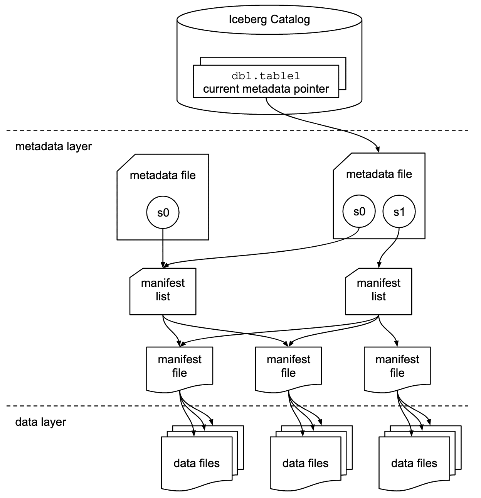

## Apache Iceberg란?

Parquet 파일이 여러 개 있다고 해서 어떤 파일을 한 테이블의 데이터로 읽어야 하는지까지 정해지는 것은 아니다. 파일을 추가하거나 교체할 때 현재 유효한 파일 목록을 관리할 방법이 필요하다.

Apache Iceberg는 이 역할을 하는 **오픈 테이블 포맷**이다. Parquet, Avro, ORC 같은 파일 포맷이 개별 파일의 저장 방식을 정의한다면 테이블 포맷은 여러 파일을 하나의 논리적 테이블로 관리하는 규칙을 정의한다.

일반적인 데이터 레이크에서는 디렉터리와 파일 경로를 기준으로 데이터를 관리한다. 이 방식은 파일이 많아지거나 여러 작업이 동시에 데이터를 변경할 때 다음과 같은 문제를 만든다.

- 어떤 파일이 현재 테이블에 포함되는지 판단하기 어렵다.
- 쓰기 작업 도중 실패하면 불완전한 파일이 남을 수 있다.
- 스키마나 파티션 구조를 변경하기 어렵다.
- 과거 시점의 테이블 상태를 재현하기 어렵다.

Iceberg는 파일 목록과 테이블 상태를 메타데이터로 관리한다. Spark와 Flink, Trino 같은 처리 엔진은 디렉터리 전체를 탐색하는 대신 이 메타데이터를 따라 읽을 파일을 찾는다.

## 테이블 변경을 관리하는 방식

### 변경을 한 번에 공개하기

Iceberg는 새 메타데이터를 만든 뒤 현재 테이블 상태를 가리키는 참조를 원자적으로 교체해 커밋한다. 커밋이 끝나기 전의 중간 상태를 읽기 작업에 노출하지 않는 방식이다. 이때 원자적인 교체를 보장하는 방법은 카탈로그와 저장소 구현에 따라 달라진다.

여러 쓰기 작업이 동시에 실행될 때는 낙관적 동시성 제어를 사용한다. 커밋 대상이 이미 변경되었다면 충돌을 감지하고 작업을 재시도하거나 실패시켜 테이블 상태를 보호한다.

### 스냅샷과 타임 트래블

데이터 추가와 삭제 등이 커밋되면 새로운 **스냅샷(snapshot)** 으로 그 상태를 관리한다. 스냅샷은 특정 시점에 유효한 데이터 파일과 필요한 삭제 파일의 집합을 나타낸다. 스키마 변경처럼 메타데이터만 바꾸는 작업까지 모두 새 데이터 스냅샷을 만드는 것은 아니다.

스냅샷이 남아 있으면 다음과 같은 작업을 할 수 있다.

- 특정 시점이나 스냅샷 ID를 기준으로 과거 데이터 조회
- 잘못된 변경 이전 상태 확인과 롤백
- 동일한 스냅샷을 사용한 재현 가능한 분석

스냅샷은 데이터 파일 전체를 매번 복사하지 않는다. 변경되지 않은 매니페스트와 데이터 파일을 재사용하므로 메타데이터 중심으로 버전을 관리할 수 있다.

예를 들어 첫 스냅샷에서 `orders-1.parquet`을 읽고 있었다고 하자. 다음 날 `orders-2.parquet`을 추가하면 새 스냅샷은 두 파일을 참조하고 이전 스냅샷은 첫 파일만 참조한다. 데이터를 전부 복사하지 않고 참조하는 파일 집합을 달리해 상태를 구분하는 것이다.

스냅샷과 관련 파일을 정리하면 과거 상태를 조회하지 못할 수 있다. 타임 트래블은 별도 백업을 자동으로 대신해주는 기능은 아니다.

### 필드 ID로 컬럼 추적하기

Iceberg는 컬럼 이름이나 위치가 아니라 고유한 **필드 ID**로 컬럼을 추적한다. 따라서 기존 데이터 파일을 즉시 다시 쓰지 않고도 컬럼 추가, 삭제, 이름 변경, 순서 변경과 일부 타입 확장을 처리할 수 있다.

### 히든 파티셔닝과 파티션 변경

Iceberg는 `day(event_time)`, `bucket(16, id)`처럼 원본 컬럼과 변환 규칙의 관계를 파티션 스펙으로 관리한다. 사용자는 별도의 파티션 컬럼을 직접 생성하거나 쿼리 조건에 파티션 값을 명시할 필요가 없다.

파티션 전략이 바뀌어도 기존 파일을 즉시 재작성하지 않는다. 기존 데이터는 이전 파티션 스펙을 유지하고 새 데이터부터 새 스펙을 적용할 수 있다. 쿼리 엔진은 각 스펙에 맞는 필터를 계산해 두 구조를 함께 조회한다.

### 여러 엔진에서 같은 테이블 사용하기

Iceberg는 특정 처리 엔진에 종속되지 않는다. 여러 엔진이 같은 테이블 메타데이터와 데이터 파일을 공유할 수 있고 데이터는 S3 같은 오브젝트 스토리지나 HDFS 등에 저장할 수 있다. 다만 읽기와 쓰기 기능은 엔진과 Iceberg 버전별 지원 범위를 확인해야 한다.

## 메타데이터에서 데이터 파일까지



Iceberg 테이블은 다음 순서로 실제 데이터 파일에 도달한다.

```text
Catalog
└─ Table Metadata (metadata.json)
   └─ Snapshot
      └─ Manifest List
         └─ Manifest Files
            ├─ Data Files
            └─ Delete Files
```

각 계층에는 다음에 읽을 파일의 위치나 요약 정보가 담긴다. 쿼리 엔진은 이 정보를 따라가며 읽을 필요가 없는 파일을 제외한다.

### 카탈로그

카탈로그는 `analytics.orders` 같은 테이블 식별자를 현재 `metadata.json` 파일의 위치로 연결한다. 테이블의 최신 상태를 찾는 시작점이자, 새 메타데이터를 현재 버전으로 교체하는 커밋 지점이다.

대표적인 구현은 다음과 같다.

- REST Catalog
- Hive Metastore
- Hadoop Catalog
- JDBC Catalog
- AWS Glue Catalog
- Project Nessie

### 테이블 메타데이터 파일

`metadata.json`은 테이블 전체의 현재 구성을 정의한다.

- 현재 스키마와 필드 ID
- 파티션 스펙과 정렬 순서
- 테이블 속성과 저장 위치
- 유효한 스냅샷 목록과 현재 스냅샷
- 스냅샷 로그와 메타데이터 변경 이력

테이블 구성이 변경되면 기존 파일을 덮어쓰지 않고 새로운 메타데이터 파일을 만든다. 카탈로그가 새 파일을 가리키는 데 성공해야 변경이 최종 커밋된다.

### 스냅샷과 매니페스트 리스트

스냅샷은 특정 시점의 테이블 상태이며 하나의 **매니페스트 리스트(manifest list)** 를 가리킨다. 매니페스트 리스트에는 해당 스냅샷을 구성하는 매니페스트 파일과 다음과 같은 요약 정보가 담긴다.

- 매니페스트가 사용하는 파티션 스펙
- 파티션 값의 범위
- 추가되거나 삭제된 파일 수

쿼리 엔진은 이 통계를 사용해 조건과 관련 없는 매니페스트를 먼저 제외한다.

### 매니페스트 파일

매니페스트 파일은 스냅샷을 구성하는 데이터 파일 또는 삭제 파일의 목록을 저장한다. 각 항목에는 파일 경로뿐 아니라 다음 정보도 포함된다.

- 파일 상태(추가, 기존, 삭제)
- 파티션 값
- 레코드 수와 파일 크기
- 컬럼별 null 개수와 값의 상·하한 등 통계

이 통계를 이용하면 쿼리 조건을 만족할 가능성이 없는 데이터 파일을 실제로 열기 전에 제외할 수 있다.

### 데이터 파일과 삭제 파일

데이터 파일에는 실제 행 데이터가 저장된다. 일반적으로 Parquet, Avro, ORC 형식을 사용한다.

Iceberg v2 테이블은 기존 데이터 파일을 즉시 다시 쓰지 않고 행을 삭제할 수 있도록 삭제 파일도 사용할 수 있다. 삭제 파일은 특정 파일의 행 위치를 기록하는 position delete와 키 값을 기록하는 equality delete 방식으로 나뉜다.

파티션은 이 그림에서 별도의 메타데이터 계층으로 들어가지는 않는다. 파일이 속한 파티션 값은 매니페스트의 파일 정보에 기록된다.

## 쿼리가 데이터 파일을 찾는 과정

예를 들어 날짜 조건이 포함된 쿼리를 실행하면 다음 순서로 읽기 대상을 줄인다.

1. 카탈로그에서 현재 테이블 메타데이터 위치를 조회한다.
2. 현재 스냅샷과 매니페스트 리스트를 확인한다.
3. 파티션 값 범위를 이용해 불필요한 매니페스트를 제외한다.
4. 매니페스트의 파티션 정보와 컬럼 통계로 데이터 파일을 다시 필터링한다.
5. 남은 데이터 파일만 처리 엔진이 읽는다.

예를 들어 어떤 파일의 주문 날짜 최솟값과 최댓값이 모두 1월인데 쿼리는 2월 주문만 찾는다면 그 파일을 제외할 수 있다. 파일을 열어 모든 행을 확인하기 전에 범위 통계로 읽기 대상을 줄이는 방식이다.

## 메타데이터를 쿼리로 확인하기

Spark에서 Iceberg 카탈로그와 테이블을 준비했다면 메타데이터 테이블을 조회할 수 있다. 아래의 `local.analytics.orders`는 자신의 테이블 식별자로 바꾼다.

```sql
SELECT committed_at, snapshot_id, operation
FROM local.analytics.orders.snapshots
ORDER BY committed_at DESC;

SELECT file_path, record_count, file_size_in_bytes
FROM local.analytics.orders.files;
```

첫 쿼리는 남아 있는 스냅샷을 확인하고 두 번째는 현재 스냅샷의 파일 정보를 확인한다. 행 수와 파일 수를 혼동하지 말고 어떤 스냅샷과 파일을 보고 있는지 함께 확인하면 구조를 이해하기 쉽다.

## 마무리

Iceberg는 데이터 파일을 바꾸는 것뿐 아니라 현재 테이블이 어떤 파일을 읽어야 하는지 관리한다. 카탈로그에서 메타데이터와 스냅샷을 거쳐 파일을 찾는 흐름을 알아두면 타임 트래블과 파일 스키핑이 어떻게 가능한지도 이해하기 쉽다.

운영 단계에서는 스냅샷과 작은 파일이 계속 누적되므로 별도의 유지 관리가 필요하다. 관련 내용은 [Apache Iceberg 테이블 유지 관리 작업과 자동화 설계](/data/iceberg-table-maintenance/)에서 이어서 다룬다.

## 참고자료

- [Apache Iceberg 공식 문서](https://iceberg.apache.org/docs/latest/)
- [Apache Iceberg Table Spec](https://iceberg.apache.org/spec/)
- [Apache Iceberg Partitioning](https://iceberg.apache.org/docs/latest/partitioning/)
- [Apache Iceberg Evolution](https://iceberg.apache.org/docs/latest/evolution/)
- [Spark에서 Iceberg 메타데이터 조회](https://iceberg.apache.org/docs/latest/spark-queries/#inspecting-tables)
