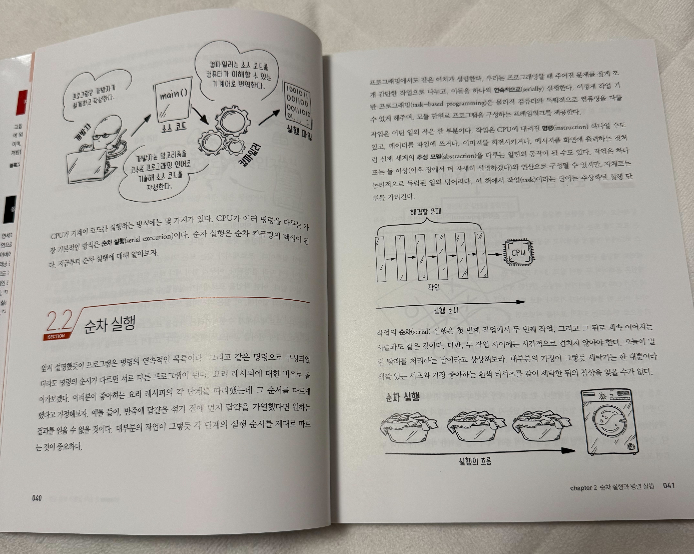
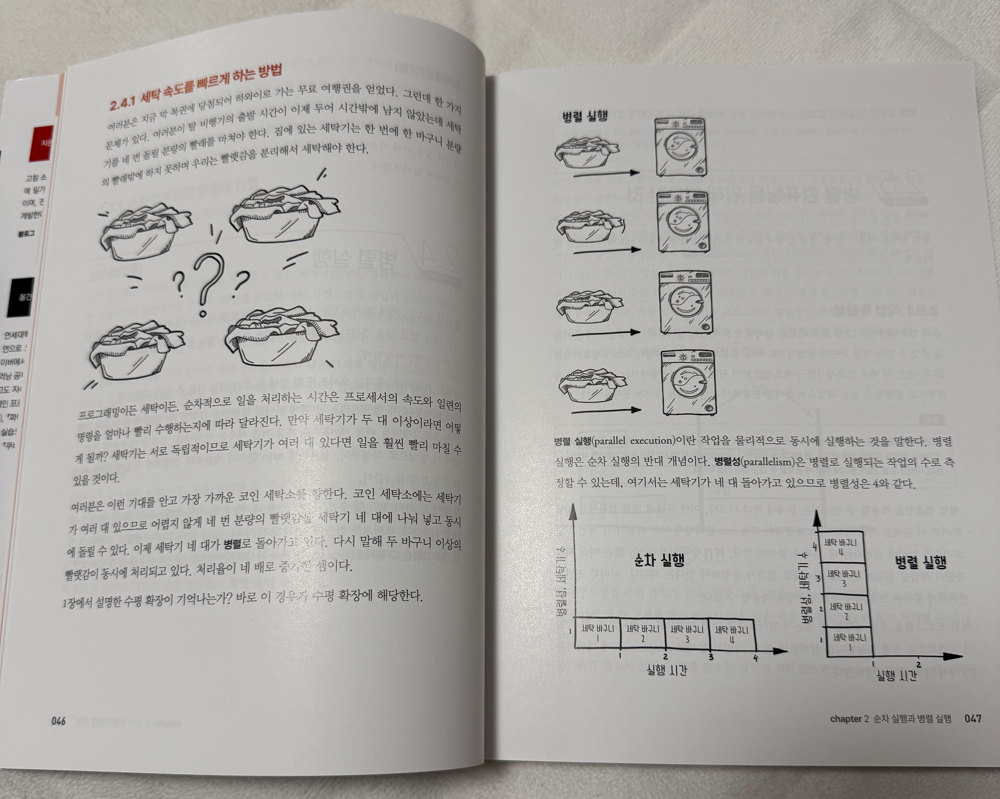
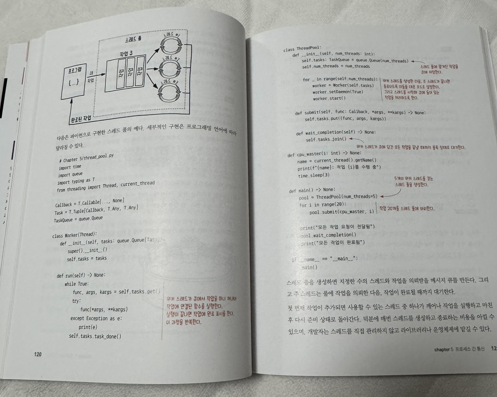
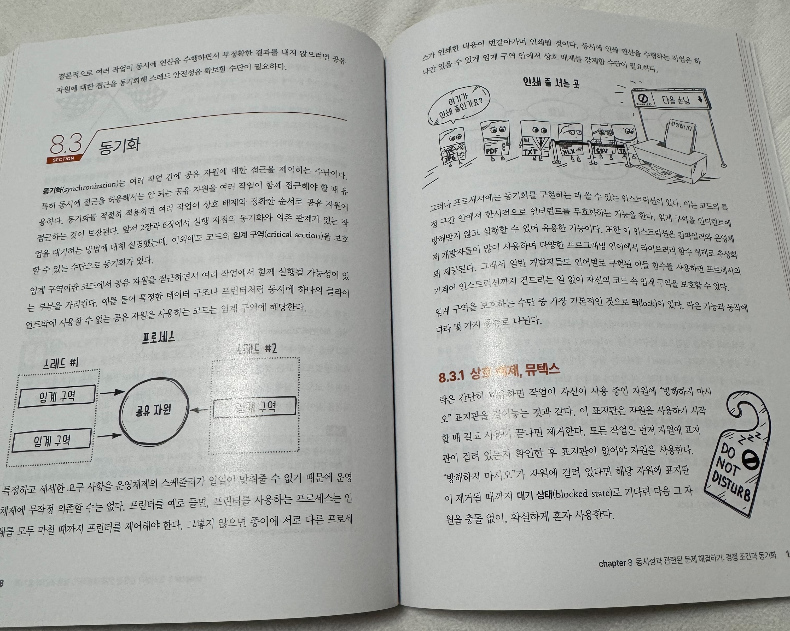
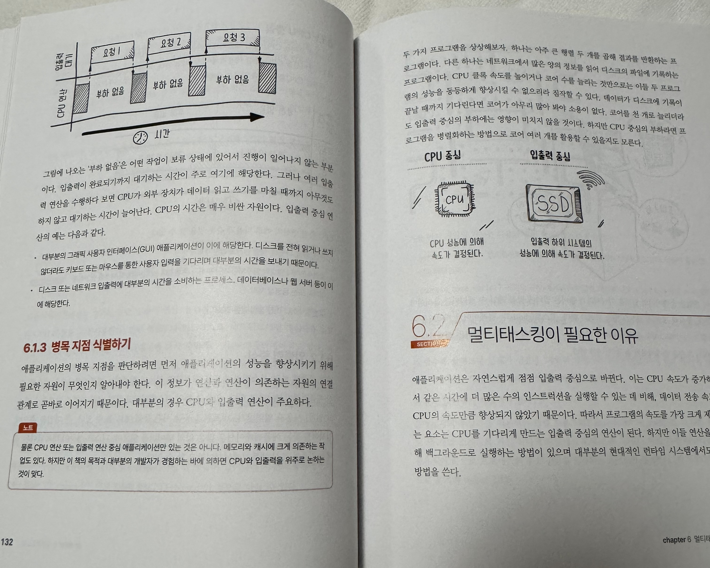

## 동시성을 다시 정리해보고 싶었던 이유

데이터 파이프라인을 만들다 보면 여러 요청을 보내거나 파티션을 나누어 작업을 실행하게 된다. 모두 “동시에 처리한다”고 표현하지만 실제 동작은 다르다. 외부 응답을 기다리는 시간을 겹치는 것과 여러 코어에서 계산하는 것을 먼저 구분할 필요가 있다.

『그로킹 동시성』은 이런 개념을 그림과 Python 예제로 설명하는 책이다. 수식이나 용어부터 외우기보다 여러 작업이 어떤 자원을 나누어 쓰는지 따라갈 수 있다는 점이 좋았다.

아래는 책을 읽으며 데이터 엔지니어링과 연결해 정리한 내용이다. Spark나 Kafka의 구체적인 설정을 알려주는 책이라기보다 해당 도구의 실행 방식을 이해할 때 필요한 기초를 다시 보는 데 가깝다.

## 동시성과 병렬성은 같은 뜻일까?

**동시성**은 여러 작업을 함께 진행하는 구조이고 **병렬성**은 여러 작업을 실제로 같은 시각에 실행하는 것이다. 동시성이 단지 동시에 보이는 흉내만을 뜻하는 것은 아니다. 여러 코어에서 병렬로 실행하는 프로그램도 동시성을 가질 수 있다.

예를 들어 API 다섯 개의 응답을 기다리는 시간을 `asyncio`로 겹칠 수 있다. 하나의 이벤트 루프 스레드에서도 가능한 방식이다. 반면 여러 CPU 코어에 계산을 나누어 실제로 함께 실행하면 병렬 처리이다.

여러 작업을 나눈다고 전체 시간이 그만큼 줄어들지는 않는다. 순서대로 실행해야 하는 부분이나 결과를 모으는 비용이 남아 있기 때문이다. 책에서 다루는 암달의 법칙도 이런 한계를 이해하는 데 연결된다.

## 프로세스와 스레드를 구분하기

프로세스는 보통 서로 다른 주소 공간을 사용하고 스레드는 같은 프로세스의 메모리를 공유한다. 그렇다고 프로세스끼리 아무 영향도 주지 않는 것은 아니다. 같은 CPU와 디스크, DB나 파일을 사용할 수 있다.

스레드는 데이터를 공유하기 쉽지만 같은 값을 동시에 바꾸면 실행 순서에 따라 결과가 달라질 수 있다. 프로세스를 사용해도 같은 외부 테이블이나 파일을 수정하면 동시 접근 문제는 여전히 남는다.

Spark도 단순히 “프로세스 방식” 하나로만 설명하기 어렵다. Executor는 프로세스이고 그 안에서는 여러 스레드가 Task를 실행한다. 도구 이름을 프로세스나 스레드 중 하나에 대응시키기보다 실제로 어떤 단위가 실행되는지 보아야 한다.

Python에서는 GIL이 활성화된 CPython을 기준으로 계산과 I/O 대기를 나누어 생각할 수 있다. 관련 예제는 [멀티프로세싱과 멀티스레딩 비교](/language/[Python]-파이썬-멀티프로세싱과-멀티스레딩/)에 정리했다.

## 비동기 I/O는 기다림을 없애는 것이 아니다

네트워크나 DB 응답을 기다리는 동안 다른 작업을 진행하면 대기 시간을 함께 사용할 수 있다. 비동기 I/O가 유용한 이유이다. 하지만 요청 자체가 더 빨리 끝난다는 뜻은 아니다.

예를 들어 외부 API 하나의 응답이 1초 걸린다면 비동기로 바꿔도 그 서버의 응답 시간이 없어지지는 않는다. 서로 독립적인 요청 여러 개의 대기를 겹칠 수 있을 뿐이다. 앞선 요청 결과가 다음 요청의 입력이라면 같은 방식으로 겹치기 어렵다.

이런 구성에서도 동시 요청 수를 제한해야 한다. 수집 쪽 대기 시간이 줄어든 대신 상대 API나 DB에 요청이 몰릴 수 있기 때문이다. 비동기를 적용할 때는 오류와 타임아웃, 재시도까지 함께 생각하게 된다.

## 동시에 바꾸는 데이터는 어떻게 보호할까?

두 작업이 같은 카운터를 읽고 각각 1을 더한 뒤 저장하면 증가분 하나가 사라질 수 있다. 실행 순서에 따라 결과가 달라지는 경쟁 조건의 예이다.

공유 값을 보호하는 방법에는 락이나 원자적 연산 등이 있다. DB에 값을 저장한다면 트랜잭션과 격리 수준도 관련된다. Python 프로세스 안에서 잡은 락 하나가 다른 서버의 쓰기까지 막아주는 것은 아니다.

락을 추가하는 것만으로 모든 문제가 끝나지는 않는다. 한 작업이 A를 잡고 B를 기다리는 동안 다른 작업이 B를 잡고 A를 기다리면 교착 상태가 생길 수 있다. 자원을 얻는 순서를 맞추거나 기다림을 제한하고 재시도하는 방식 등을 검토해야 한다.

## 데이터 파이프라인에 연결해보기

책의 개념을 실제 도구에 연결할 때는 “이 기술을 쓰면 빨라진다”보다 무엇을 동시에 실행하는지부터 확인하는 편이 좋았다.

| 상황 | 먼저 확인할 것 |
|---|---|
| API 수집 | 요청들이 독립적인지와 상대 서버의 동시 요청 제한 |
| Spark 파티션 처리 | Task 수와 실행 슬롯·셔플·데이터 편중 |
| 스트리밍에서 외부 DB 조회 | 응답 대기를 겹칠 수 있는지와 결과 순서·타임아웃 |
| 여러 ETL 태스크 실행 | 선후 관계와 공통으로 수정하는 테이블·파일 |

예를 들어 Flink의 Async I/O는 외부 시스템 응답을 기다리는 시간을 겹치는 기능이다. 반면 모든 스트리밍 작업이 “스레드 기반이어서 더 유리하다”는 식으로 구분되지는 않는다.

Spark도 배치만을 위한 도구는 아니고 Flink도 스트림만 처리하는 것은 아니다. 프레임워크의 실행 모델과 각 작업이 기다리는 자원을 함께 보아야 한다.

## 마무리

이 책은 동시성과 병렬성, 프로세스와 스레드를 막연하게 묶어 생각할 때 기초를 다시 정리하기 좋았다. 그림과 예제로 개념을 따라간 뒤 실제 파이프라인에서 어떤 자원을 공유하고 무엇을 기다리는지 연결해보는 방식으로 읽을 수 있었다.

동시성을 높이는 것 자체가 목적은 아니다. 처리 시간을 줄이면서도 결과가 빠지거나 중복되지 않는지와 다른 시스템이 그 요청을 감당할 수 있는지를 함께 확인해야 한다.

이 글은 길벗 출판사에서 책을 제공받아 작성했다.

## 참고자료

- [Grokking Concurrency 원서 소개와 목차](https://www.manning.com/books/grokking-concurrency)
- [Python asyncio의 코루틴과 태스크](https://docs.python.org/3/library/asyncio-task.html)
- [Spark 실행 프로세스와 Task](https://spark.apache.org/docs/3.5.6/cluster-overview.html)
- [Flink Async I/O](https://nightlies.apache.org/flink/flink-docs-release-1.19/docs/dev/datastream/operators/asyncio/)
