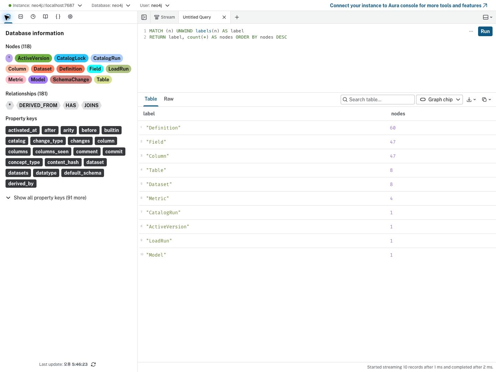
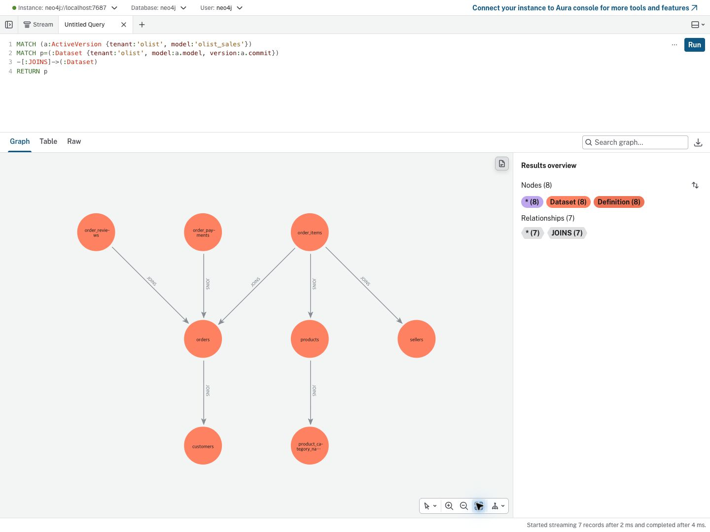
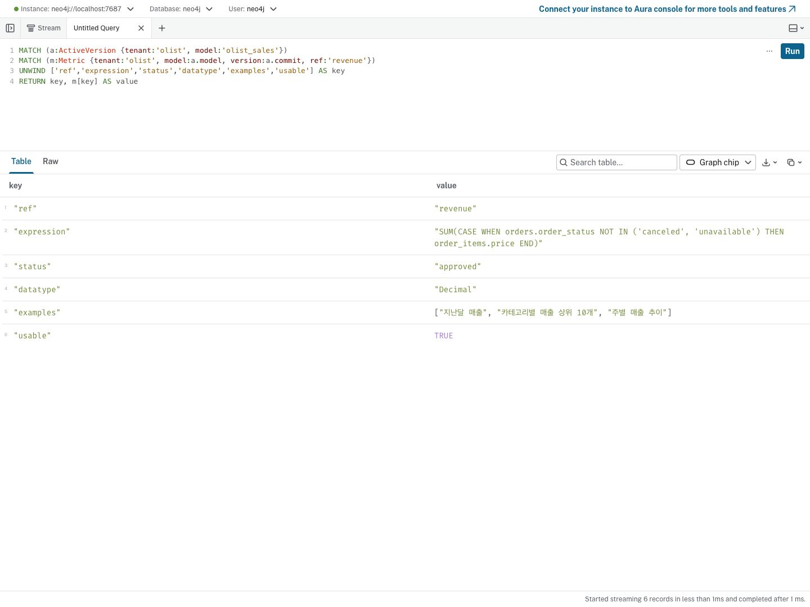
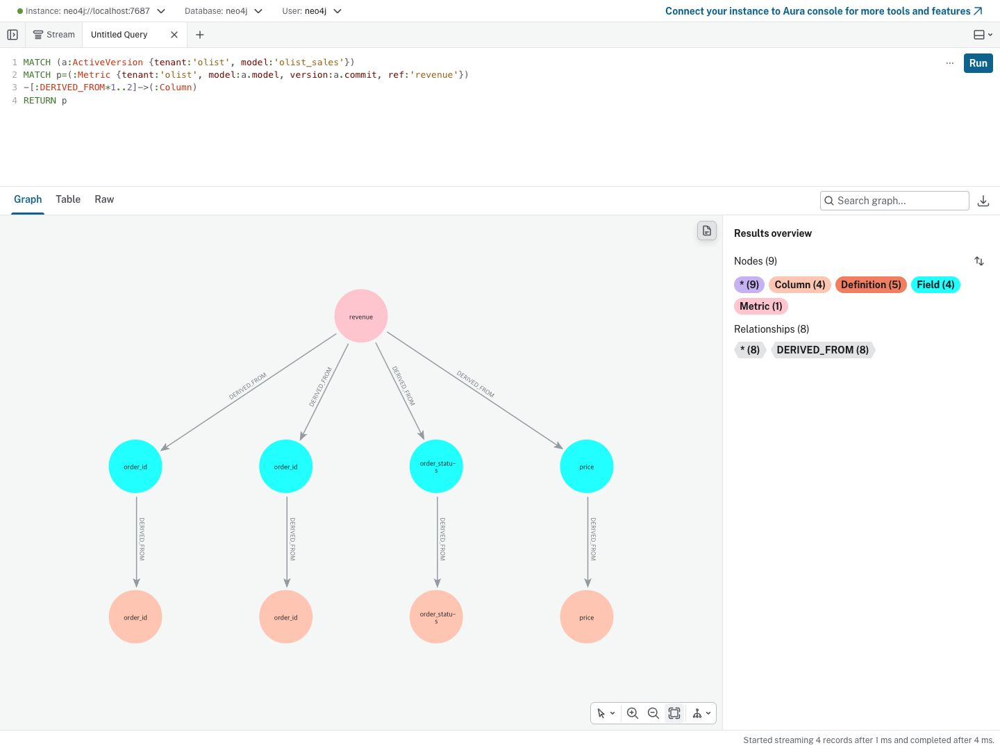

<style>
/* tech-log-html viz kit v1 — 블로그(Minimal Mistakes) 본문 안에서만 동작하도록 모든 선택자를 .tlv 아래로 스코프한다 */
.tlv{--tlv-ink:#000;--tlv-body:#101010;--tlv-sub:#393939;--tlv-mute:#6b6b6b;--tlv-line:#e6e6e6;--tlv-line-2:#bfbfbf;--tlv-soft:#f8f8f8;--tlv-accent:#ff6c02;--tlv-accent-2:#ff984e;--tlv-accent-line:rgba(255,108,2,.3);--tlv-accent-bg:rgba(255,108,2,.07);--tlv-accent-text:#c24e00;--tlv-good:#1a7f37;--tlv-good-bg:rgba(26,127,55,.08);--tlv-bad:#c0272d;--tlv-bad-bg:rgba(192,39,45,.07);--tlv-mono:"Fira Mono",Pretendard,Monaco,Consolas,"Lucida Console",monospace;display:block;margin:1.75em 0;color:var(--tlv-body);line-height:1.6}
figure.tlv{display:block;padding:0}
.tlv *,.tlv *::before,.tlv *::after{box-sizing:border-box}
.tlv p{margin:.4em 0;font-size:.9em}
.tlv ul,.tlv ol{margin:0;padding:0;list-style:none}
.tlv li{margin:0}
.tlv button{font:inherit;cursor:pointer}
.tlv button:focus-visible{outline:2px solid var(--tlv-accent);outline-offset:2px}
.tlv div.highlighter-rouge{margin:0}
.tlv-cap{display:block;margin-top:.7em;font-size:.78em;line-height:1.5;color:var(--tlv-sub)}
.tlv-cap b{color:var(--tlv-ink);font-weight:600;margin-right:.35em}
.tlv-box{border:1px solid var(--tlv-line);border-radius:4px;padding:1em 1.1em}
/* SVG */
.tlv-scroll{overflow-x:auto;-webkit-overflow-scrolling:touch}
.tlv-svg{display:block;width:100%;height:auto;color:var(--tlv-body);font-family:inherit;overflow:visible}
.tlv-scroll>.tlv-svg{min-width:var(--tlv-min,560px)}
.tlv-svg .t{font-size:13px;font-weight:600;fill:var(--tlv-ink)}
.tlv-svg .s{font-size:11.5px;fill:var(--tlv-sub)}
.tlv-svg .l{font-size:11px;font-family:var(--tlv-mono);fill:var(--tlv-mute)}
.tlv-svg .box{fill:#fff;stroke:var(--tlv-line-2);stroke-width:1}
.tlv-svg .soft{fill:var(--tlv-soft);stroke:var(--tlv-line);stroke-width:1}
.tlv-svg .accent{fill:var(--tlv-accent-bg);stroke:var(--tlv-accent);stroke-width:1.2}
.tlv-svg .good{fill:var(--tlv-good-bg);stroke:var(--tlv-good);stroke-width:1.2}
.tlv-svg .bad{fill:var(--tlv-bad-bg);stroke:var(--tlv-bad);stroke-width:1.2}
.tlv-svg .wire{fill:none;stroke:var(--tlv-mute);stroke-width:1.2}
.tlv-svg .wire-accent{fill:none;stroke:var(--tlv-accent);stroke-width:1.6}
.tlv-svg .dash{stroke-dasharray:4 3}
.tlv-svg .c-accent{fill:var(--tlv-accent-text)}
.tlv-svg .c-good{fill:var(--tlv-good)}
.tlv-svg .c-bad{fill:var(--tlv-bad)}
.tlv-svg .mk{fill:var(--tlv-mute)}
.tlv-svg .mk-accent{fill:var(--tlv-accent)}
.tlv-svg .bar{fill:var(--tlv-accent-2)}
.tlv-svg .bar-mute{fill:var(--tlv-line-2)}
/* chip · legend */
.tlv-chip{display:inline-block;padding:.05em .55em;border-radius:1000px;font-size:.72em;font-weight:600;line-height:1.7;background:var(--tlv-soft);color:var(--tlv-sub);border:1px solid var(--tlv-line)}
.tlv-chip.is-accent{background:var(--tlv-accent-bg);color:var(--tlv-accent-text);border-color:var(--tlv-accent-line)}
.tlv-chip.is-good{background:var(--tlv-good-bg);color:var(--tlv-good);border-color:transparent}
.tlv-chip.is-bad{background:var(--tlv-bad-bg);color:var(--tlv-bad);border-color:transparent}
.tlv-legend{display:flex;flex-wrap:wrap;gap:.3em 1.1em;font-size:.75em;color:var(--tlv-sub);margin-bottom:.6em}
.tlv-legend span::before{content:"";display:inline-block;width:.8em;height:.8em;border-radius:2px;margin-right:.4em;vertical-align:-.05em;background:var(--sw,var(--tlv-accent-2))}
/* stats */
.tlv-stats{display:grid;grid-template-columns:repeat(auto-fit,minmax(128px,1fr));gap:8px}
.tlv-stat{border:1px solid var(--tlv-line);border-radius:4px;padding:.8em .9em}
.tlv-stat .n{font-size:1.45em;font-weight:700;line-height:1.2;color:var(--tlv-ink);font-variant-numeric:tabular-nums}
.tlv-stat .n small{font-size:.55em;font-weight:600;margin-left:.15em;color:var(--tlv-sub)}
.tlv-stat .l{font-size:.75em;color:var(--tlv-sub);margin-top:.25em}
.tlv-stat .d{font-size:.72em;font-weight:600;margin-top:.2em}
.tlv-stat .d.is-good{color:var(--tlv-good)}.tlv-stat .d.is-bad{color:var(--tlv-bad)}
/* bars — 가로 막대 비교 */
.tlv-bars{display:grid;gap:.55em}
.tlv-bar-row{display:grid;grid-template-columns:minmax(0,34%) 1fr 3.6em;align-items:center;gap:.4em .8em;font-size:.8em}
.tlv-bar-row .k{color:var(--tlv-body);line-height:1.35}
.tlv-bar-row .v{text-align:right;font-variant-numeric:tabular-nums;font-weight:600;color:var(--tlv-ink)}
.tlv-track{display:grid;gap:3px}
.tlv-track i{display:block;height:9px;border-radius:2px;background:var(--tlv-accent-2);width:var(--w,0%);min-width:2px}
.tlv-track i.is-mute{background:var(--tlv-line-2)}
.tlv-track i.is-good{background:var(--tlv-good)}
.tlv-track i.is-bad{background:var(--tlv-bad)}
/* compare — 2단 전후 비교 */
.tlv-compare{display:grid;grid-template-columns:1fr 1fr;gap:10px}
.tlv-col{min-width:0;border:1px solid var(--tlv-line);border-radius:4px;overflow:hidden}
.tlv-col>.hd{display:flex;align-items:center;gap:.5em;padding:.45em .8em;border-bottom:1px solid var(--tlv-line);font-size:.78em;font-weight:600;color:var(--tlv-ink);background:#fff}
.tlv-col>.bd{padding:.6em .8em;font-size:.9em}
.tlv-col>.bd.is-code{padding:0}
.tlv-col>.bd.is-code pre.highlight{margin:0;border-radius:0}
/* flow — HTML 파이프라인 */
.tlv-flow{display:flex;align-items:stretch;gap:0}
.tlv-node{flex:1 1 0;min-width:0;border:1px solid var(--tlv-line-2);border-radius:4px;padding:.65em .75em;background:#fff}
.tlv-node .nt{font-size:.8em;font-weight:600;color:var(--tlv-ink);line-height:1.35;word-break:keep-all}
.tlv-node .ns{font-size:.7em;color:var(--tlv-sub);line-height:1.45;margin-top:.25em;word-break:keep-all}
.tlv-node code{font-size:.95em}
.tlv-node.is-accent{border-color:var(--tlv-accent);background:var(--tlv-accent-bg)}
.tlv-node.is-good{border-color:var(--tlv-good);background:var(--tlv-good-bg)}
.tlv-node.is-bad{border-color:var(--tlv-bad);background:var(--tlv-bad-bg)}
.tlv-node.is-mute{border-style:dashed;color:var(--tlv-mute)}
.tlv-arrow{flex:0 0 1.9em;display:flex;align-items:center;justify-content:center;color:var(--tlv-mute);font-size:.85em;position:relative}
.tlv-arrow::before{content:"→"}
.tlv-arrow[data-label]::after{content:attr(data-label);position:absolute;top:calc(50% + .8em);font-size:.7em;white-space:nowrap;color:var(--tlv-mute)}
/* tabs */
.tlv-tablist{display:none;flex-wrap:wrap;gap:0;border-bottom:1px solid var(--tlv-line);margin-bottom:.8em}
.tlv-tabs.is-ready>.tlv-tablist{display:flex}
.tlv-tab{background:none;border:0;border-bottom:2px solid transparent;margin-bottom:-1px;padding:.45em .9em;font-size:.8em;color:var(--tlv-sub);white-space:nowrap}
.tlv-tab[aria-selected="true"]{color:var(--tlv-ink);font-weight:600;border-bottom-color:var(--tlv-accent)}
.tlv-panel>.tlv-panel-title{font-size:.78em;font-weight:600;color:var(--tlv-sub);margin:.2em 0 .4em}
.tlv-tabs.is-ready .tlv-panel-title{display:none}
.tlv-tabs:not(.is-ready) .tlv-panel+.tlv-panel{margin-top:1em}
/* steps — 단계별 강조 도해 */
.tlv-steps-ctrl{display:none;align-items:center;flex-wrap:wrap;gap:.35em;margin-top:.8em}
.tlv-steps.is-ready .tlv-steps-ctrl{display:flex}
.tlv-steps.is-ready .tlv-step-list{display:none}
.tlv-step-btn{min-width:2em;height:2em;border:1px solid var(--tlv-line-2);border-radius:4px;background:#fff;font-size:.78em;color:var(--tlv-sub)}
.tlv-step-btn[aria-pressed="true"]{border-color:var(--tlv-accent);background:var(--tlv-accent-bg);color:var(--tlv-accent-text);font-weight:600}
.tlv-step-btn.is-all{padding:0 .7em}
.tlv-step-note{flex:1 1 100%;margin-top:.35em;font-size:.82em;color:var(--tlv-body);min-height:1.6em}
.tlv-step-list{counter-reset:s;margin-top:.8em !important}
.tlv-step-list li{counter-increment:s;font-size:.82em;padding-left:1.8em;position:relative;margin:.25em 0}
.tlv-step-list li::before{content:counter(s);position:absolute;left:0;top:.1em;width:1.35em;height:1.35em;border-radius:50%;background:var(--tlv-accent-bg);color:var(--tlv-accent-text);font-size:.85em;font-weight:600;display:flex;align-items:center;justify-content:center}
.tlv-steps [data-steps]{transition:opacity .25s}
.tlv-steps.is-ready.is-focus [data-steps]:not(.is-on){opacity:.18}
/* timeline */
.tlv-timeline li{position:relative;padding:0 0 .9em 1.4em;border-left:1px solid var(--tlv-line-2);margin-left:.35em}
.tlv-timeline li:last-child{border-left-color:transparent;padding-bottom:0}
.tlv-timeline li::before{content:"";position:absolute;left:-.36em;top:.45em;width:.7em;height:.7em;border-radius:50%;background:#fff;border:2px solid var(--tlv-line-2)}
.tlv-timeline li.is-accent::before{border-color:var(--tlv-accent);background:var(--tlv-accent)}
.tlv-timeline li.is-bad::before{border-color:var(--tlv-bad)}
.tlv-timeline li.is-good::before{border-color:var(--tlv-good)}
.tlv-timeline .when{display:block;font-size:.72em;font-family:var(--tlv-mono);color:var(--tlv-mute)}
.tlv-timeline .what{display:block;font-size:.86em;line-height:1.55}
/* term — 터미널 로그 */
.tlv.tlv-term{border-radius:4px;overflow:hidden;background:#1d1f21;color:#e6e6e6;font-family:var(--tlv-mono);font-size:.76em;line-height:1.65}
.tlv-term .bar{display:flex;align-items:center;gap:6px;padding:.5em .8em;background:#2a2c2f;color:#9a9a9a;font-size:.9em}
.tlv-term .bar i{width:10px;height:10px;border-radius:50%;background:#ff5f57}
.tlv-term .bar i:nth-child(2){background:#febc2e}.tlv-term .bar i:nth-child(3){background:#28c840;margin-right:.5em}
.tlv-term .body{padding:.8em 1em;overflow-x:auto;white-space:pre}
.tlv-term .ln{display:block;min-height:1.65em}
.tlv-term .ln.is-ok{color:#7ee2a0}.tlv-term .ln.is-err{color:#ff8b8b}.tlv-term .ln.is-dim{color:#8a8a8a}
.tlv-term .p{color:#ff984e}
.tlv-term.is-playing .ln{visibility:hidden}.tlv-term.is-playing .ln.is-shown{visibility:visible}
/* mobile */
@media (max-width:600px){
.tlv-compare{grid-template-columns:1fr}
.tlv-flow{flex-direction:column}
.tlv-arrow{flex-basis:1.6em}
.tlv-arrow::before{content:"↓"}
.tlv-arrow[data-label]::after{top:auto;left:calc(50% + 1em)}
.tlv-bar-row{grid-template-columns:1fr 3.4em}
.tlv-bar-row .k{grid-column:1/-1}
}
@media (prefers-reduced-motion:reduce){.tlv *{transition:none !important;animation:none !important}}
</style>


<style>
.tlv img{display:block;width:100%;height:auto;border:1px solid var(--tlv-line);border-radius:4px}
</style>

## 1. 배경

앞선 글에서는 Apache Ossie로 시맨틱 정의를 관리하고 승인된 정의를 Neo4j에 적재하는 흐름을 설계했다. 정의를 Neo4j에 넣으려면 그래프에서 어떤 노드와 관계를 사용할지도 정해야 했다.

Ossie YAML의 정의만 옮겨서는 충분하지 않았다. Text-to-SQL이 `revenue` 지표를 찾았더라도 이 지표가 어떤 필드를 계산하고 그 필드가 DB의 어느 컬럼을 사용하는지 이어서 확인할 수 있어야 한다. 반대로 `orders.order_id` 컬럼이 바뀌었을 때 영향을 받는 지표와 조인도 찾을 수 있어야 했다.

그래프는 시맨틱 정의와 DB 카탈로그 두 영역으로 나눴다. Model, Dataset, Field, Metric은 정의를 표현하고 Table과 Column은 실제 DB 스키마를 표현한다. 두 영역을 DERIVED_FROM 관계로 연결해 지표에서 원본 컬럼으로 내려가거나 컬럼에서 영향을 받는 지표를 거꾸로 찾도록 구성했다.

이 구조를 Olist 데이터셋에 적용해 노드와 관계를 Neo4j에 적재했다. `revenue` 지표의 계보와 `orders.order_id` 컬럼의 영향 범위도 실제 쿼리로 확인했다.

---

## 2. Nodes 설계

### 2.1 라벨별 역할과 식별 키

| Node label | 표현하는 대상 | 식별 키 | 생성·갱신 주체 | Olist 적재 결과 |
|---|---|---|---|---:|
| Model | 시맨틱 모델 묶음 | 정의 공통 키 | 정의 적재기 | 1 |
| Dataset | 모델 안의 데이터 소스 선언 | 정의 공통 키 | 정의 적재기 | 8 |
| Field | 데이터셋의 필드와 계산식 | 정의 공통 키 | 정의 적재기 | 47 |
| Metric | 집계 지표 정의 | 정의 공통 키 | 정의 적재기 | 4 |
| Table | DB 테이블·일반 뷰 | 물리 테이블 키 | 카탈로그 수집기 | 8 |
| Column | DB 컬럼 | 물리 컬럼 키 | 카탈로그 수집기 | 47 |
| ActiveVersion | 모델별 활성 정의 버전 | tenant, model | 정의 적재기 | 1 |
| LoadRun | 정의 적재 실행 기록 | 전용 유일 제약 없음 | 정의 적재기 | 1 |
| CatalogRun | 스키마 수집 실행 기록 | run_id로 조회, 유일 제약 없음 | 카탈로그 수집기 | 1 |
| CatalogLock | 소스별 수집 잠금 | tenant, source_id | 카탈로그 수집기 | 0 |
| SchemaChange | 스키마 변경 이벤트 | 전용 유일 제약 없음 | 카탈로그 수집기 | 0 |

식별 키는 다음 값의 조합으로 정했다.

```text
정의 공통 키: tenant + model + version + id
물리 테이블 키: tenant + source_id + catalog + schema + name
물리 컬럼 키: tenant + source_id + catalog + schema + table + name
```

정의의 `id`에는 종류 접두어를 넣는다. `dataset:orders`, `field:orders.order_id`, `metric:revenue`가 해당한다. 사람이 사용하는 참조 이름은 `ref`에 저장한다.

Model·Dataset·Field·Metric에는 `Definition` 라벨을 함께 붙인다. `(:Definition:Metric)`은 라벨 두 개가 적용된 같은 노드다. Definition의 개수 60은 네 종류의 합계이며 전체 노드 118에 더하지 않는다.

```cypher
MATCH (n)
UNWIND labels(n) AS label
RETURN label, count(*) AS nodes
ORDER BY nodes DESC;
```

<figure class="tlv" id="tlv-2-node-capture">
<a href="/assets/images/posts/graphdb-design/01-nodes.jpg"></a>
<figcaption class="tlv-cap"><b>그림 1.</b> 라벨별 집계에서 Definition 60개는 Metric·Field·Dataset·Model과 중복 집계된다.</figcaption>
</figure>

### 2.2 정의와 카탈로그의 연결 구조

Dataset과 Field는 모델·버전별 정의를 표현한다. Table과 Column은 여러 모델에서 공유하는 DB 관측값을 표현한다. 같은 물리 컬럼을 두 모델이 다른 필드명이나 계산식으로 사용할 수 있어 별도 노드를 유지했다.

<figure class="tlv" id="tlv-2-model">
<div class="tlv-scroll" style="--tlv-min:560px">
<svg class="tlv-svg" viewBox="0 0 630 345" role="img" aria-label="Model은 Dataset과 Metric을 포함하고 정의의 Field는 카탈로그 Column에 연결된다">
<defs><marker id="tlv-2-arrow" viewBox="0 0 10 10" refX="9" refY="5" markerWidth="6" markerHeight="6" orient="auto"><path class="mk" d="M0,1 L10,5 L0,9 z"/></marker></defs>
<text class="t" x="20" y="22">정의 · 모델별 버전 관리</text><text class="t" x="425" y="22">카탈로그 · 현재 스키마</text>
<rect class="accent" x="20" y="40" width="130" height="44" rx="4"/><text class="t" x="36" y="67">Model</text>
<rect class="accent" x="20" y="145" width="130" height="44" rx="4"/><text class="t" x="36" y="172">Dataset</text>
<rect class="accent" x="220" y="145" width="130" height="44" rx="4"/><text class="t" x="236" y="172">Metric</text>
<rect class="accent" x="220" y="270" width="130" height="44" rx="4"/><text class="t" x="236" y="297">Field</text>
<rect class="box" x="455" y="145" width="150" height="44" rx="4"/><text class="t" x="471" y="172">Table</text>
<rect class="box" x="455" y="270" width="150" height="44" rx="4"/><text class="t" x="471" y="297">Column</text>
<path class="wire" d="M85 84 V141" marker-end="url(#tlv-2-arrow)"/><text class="l" x="95" y="115">HAS</text>
<path class="wire" d="M150 62 H285 V141" marker-end="url(#tlv-2-arrow)"/><text class="l" x="240" y="99">HAS</text>
<path class="wire" d="M85 189 V292 H216" marker-end="url(#tlv-2-arrow)"/><text class="l" x="100" y="281">HAS</text>
<path class="wire" d="M150 156 L199 124 H405 L451 156" marker-end="url(#tlv-2-arrow)"/><text class="l" x="260" y="115">DERIVED_FROM</text>
<path class="wire" d="M285 189 V266" marker-end="url(#tlv-2-arrow)"/><text class="l" x="294" y="235">DERIVED_FROM</text>
<path class="wire" d="M350 292 H451" marker-end="url(#tlv-2-arrow)"/><text class="l" x="358" y="280">DERIVED_FROM</text>
<path class="wire" d="M530 189 V266" marker-end="url(#tlv-2-arrow)"/><text class="l" x="540" y="235">HAS</text>
</svg>
</div>
<figcaption class="tlv-cap"><b>그림 2.</b> 정의의 필드에서 물리 컬럼으로 연결하고 같은 컬럼을 여러 모델에서 공유한다.</figcaption>
</figure>

그림의 관계 외에 데이터셋 범위 지표에는 Dataset→Metric의 HAS가 있다. 데이터셋 간 조인은 JOINS, DB 외래키는 Table→Table의 REFERENCES로 표현한다.

카탈로그는 수집할 때 갱신하고 정의는 새 버전으로 교체한다. 두 정보를 한 노드에 합치면 모델별 계산식과 승인 기준 타입, 교체 중인 이전 정의를 다시 분리해서 보관해야 한다. 그래서 정의와 카탈로그를 두 층으로 나눠 관리했다.

---

## 3. Relationships 설계

### 3.1 관계별 시작·종료 노드

| Relationship type | 시작 → 종료 | 의미 | 기준 단위 | Olist 적재 결과 |
|---|---|---|---|---:|
| HAS | Model → Dataset | 모델의 데이터셋 | 자식 Dataset당 부모 Model 1개 | 8 |
| HAS | Model 또는 Dataset → Metric | 모델·데이터셋 지표 소속 | Metric당 소속 1개 | 4 |
| HAS | Dataset → Field | 데이터셋 필드 | Field당 부모 Dataset 1개 | 47 |
| HAS | Table → Column | DB 컬럼 소속 | Column당 부모 Table 1개 | 47 |
| DERIVED_FROM | Dataset → Table | 정의의 데이터 소스 | 연결 코드 기준 Dataset당 0~1개 | 8 |
| DERIVED_FROM | Field → Column | 필드 식의 입력 컬럼 | Field당 0~N개 | 47 |
| DERIVED_FROM | Metric → Field | 지표의 필드 의존성 | Metric당 0~N개 | 13 |
| JOINS | Dataset → Dataset | 정의된 조인 규칙 | 동일 쌍에 이름이 다른 규칙 허용 | 7 |
| REFERENCES | Table → Table | DB에 선언된 FK | FK별 컬럼 쌍 기록 | 0 |

관계의 끝점 라벨과 부모 수는 DB 제약으로 강제하지 않았다. 대신 관계를 만들고 검증하는 코드에서 표의 규칙을 확인하도록 했다.

Olist 데이터를 적재해보니 HAS 106개, DERIVED_FROM 68개, JOINS 7개로 총 181개의 관계가 만들어졌다. REFERENCES 생성 코드도 추가했지만 Olist DB에는 FK가 선언돼 있지 않아 관계가 만들어지지 않았다. 쿼리 형태의 데이터 소스나 연결에 실패한 데이터셋은 Table과 연결하지 않고 진단 결과로 남긴다.

### 3.2 조인 관계와 지표 의존성

`JOINS`에는 두 데이터셋을 연결할 키를 저장한다. 엔진은 승인 상태와 대상의 기본키·유일키 선언을 확인해 실행 가능한 경로를 고른다. `n_to_1=true`는 선언된 키와 일치한다는 판정이며 실제 데이터의 유일성을 검사했다는 뜻은 아니다.

```cypher
MATCH (a:ActiveVersion {tenant:'olist', model:'olist_sales'})
MATCH p=(:Dataset {tenant:'olist', model:a.model, version:a.commit})
-[:JOINS]->(:Dataset)
RETURN p;
```

<figure class="tlv" id="tlv-3-join-capture">
<a href="/assets/images/posts/graphdb-design/04-dataset-joins-detail.jpg"></a>
<figcaption class="tlv-cap"><b>그림 3.</b> Olist 정의에 넣은 조인 7개다. 승인된 연결 3개와 초안 연결 4개를 함께 표시했다.</figcaption>
</figure>

위 쿼리는 검토용으로 초안도 보여준다. 실행 가능한 연결만 보려면 `JOINS`에 `status:'approved', n_to_1:true` 조건을 더한다.

`DERIVED_FROM {role:'join'}`은 지표를 단독 계산할 때 선택된 조인 키를 가리킨다. 조인 규칙과 지표 식에서 계산한 정보를 저장해, 해당 키가 바뀌면 지표를 역방향으로 찾도록 했다. 실제 질문의 차원·필터에 따라 추가되는 조인은 고정 지표 계보에 포함하지 않는다.

---

## 4. Property keys 설계

### 4.1 속성 사전의 기준

자료형은 적재 코드가 만드는 값을 기준으로 적었다. Neo4j에는 복합 유일성만 제약으로 걸었고 타입이나 속성의 존재 여부는 강제하지 않았다. 선택 속성에 값이 없으면 `null`을 넣지 않고 키 자체를 생략한다.

Neo4j Browser 왼쪽의 Property keys에는 이전에 사용한 키도 남는다. 그래서 속성 사전은 이 목록을 그대로 사용하지 않고 노드와 관계에 실제로 들어간 키를 조회해 만들었다.

```cypher
MATCH (n)
UNWIND labels(n) AS label
UNWIND keys(n) AS key
RETURN label, key, count(*) AS populated
ORDER BY label, key;
```

관계 속성은 `MATCH ()-[r]->()`와 `keys(r)`로 조회했다. 여기에 코드에서 만드는 선택 속성을 더해 전체 속성 사전을 만들었다.

### 4.2 정의 공통 속성

적용 대상은 Model·Dataset·Field·Metric이다. 생성 주체는 정의 적재기이며 카탈로그 수집기는 이 속성을 갱신하지 않는다.

| Property key | 타입 | 필수·선택 | 의미 |
|---|---|---|---|
| tenant | String | 식별 키 | 테넌트 범위 |
| model | String | 식별 키 | 시맨틱 모델 이름 |
| version | String | 식별 키 | 적재 버전 식별자 |
| id | String | 식별 키 | 종류 접두어를 포함한 객체 ID |
| name | String | 기본 | 선언 이름 |
| ref | String | 기본 | 엔진에서 사용하는 참조 이름 |
| description | String | 기본, 빈 문자열 허용 | 설명 |
| synonyms | List[String] | 기본, 빈 목록 허용 | 검색 동의어 |
| instructions | String | 기본, 빈 문자열 허용 | 정의 사용 지침 |
| examples | List[String] | 선택 | 자연어 질문 예시 |

`version`은 항상 순수 Git 해시인 것은 아니다. 개발 적재에서는 `+dirty`나 명시한 버전 문자열을 사용할 수 있다. `ActiveVersion.commit`에는 이 버전값이 저장된다.

### 4.3 정의 종류별 속성

| Node | 추가 Property keys | 타입·의미 |
|---|---|---|
| Model | revision | Integer, 사람이 읽는 정의 번호 |
| Model | ossie_version, source_file | String, 규격 버전과 원본 경로; source_file은 선택 |
| Dataset | source | String, 선언된 데이터 소스 |
| Dataset | primary_key, unique_keys | List[String], 기본키와 유일키; unique_keys는 키마다 컬럼명을 쉼표로 결합 |
| Dataset | src_source_id, src_catalog, src_schema, src_name | String, 카탈로그 연결용 키; 소스 해석 성공 시 생성 |
| Field | dataset, expression, datatype, label | String, 소속·식·자료형·표시명; dataset 외에는 오류·미선언 시 생략 가능 |
| Field | is_time, is_key | Boolean, 시간 필드·키 필드 여부 |
| Field | source_columns, is_passthrough | List[String], Boolean; 입력 컬럼과 단순 통과 여부, 식 분석 성공 시 생성 |
| Field | source_types | String(JSON), 승인 기준 물리 컬럼 타입; 선택 |
| Field | sensitivity | String, 정의 측 민감도; 선택 |
| Metric | expression, datatype, dataset | String, 집계 식·자료형·데이터셋 범위; 모델 지표에는 dataset이 없음 |
| Metric | status | String, draft 또는 approved; 미지정 시 draft |
| Metric | owner | String, 지표 담당자; 선택 |
| Metric | usable, engine_error | Boolean, String; 지표 식 검사 결과와 실패 내용 |

`Field.is_key`는 기본키뿐 아니라 유일키와 조인 키를 포함한다. `Metric.usable`은 지표 식 검사를 통과했는지 나타낸다. 승인 여부와 조인 경로·카탈로그 연결까지 모두 정상이라는 판정으로 사용하지 않는다.

```cypher
MATCH (a:ActiveVersion {tenant:'olist', model:'olist_sales'})
MATCH (m:Metric {tenant:'olist', model:a.model, version:a.commit, ref:'revenue'})
UNWIND ['ref','expression','status','datatype','examples','usable'] AS key
RETURN key, m[key] AS value;
```

<figure class="tlv" id="tlv-4-properties-capture">
<a href="/assets/images/posts/graphdb-design/03-metric-properties-detail.jpg"></a>
<figcaption class="tlv-cap"><b>그림 4.</b> revenue 노드에서 식·승인 상태·질문 예시를 실제 속성값으로 확인했다.</figcaption>
</figure>

### 4.4 카탈로그 속성

카탈로그 노드는 수집기가 같은 식별 키로 MERGE한다. DB에서 관측한 값과 정의에서 선언한 값은 구분한다.

| 적용 대상 | Property keys | 타입·의미 |
|---|---|---|
| Table, Column | tenant, source_id, catalog, schema, name | String, 물리 객체 식별 범위 |
| Column | table | String, 부모 테이블 이름 |
| Table | kind | String, table / view / materialized_view |
| Table | pk | List[String], DB에 선언된 기본키 |
| Table | fqn_lc, name_tokens | String, 전체 이름 소문자와 이름 검색용 토큰 |
| Table | content_hash | String, 컬럼·PK·FK 변경 비교용 해시 |
| Column | raw_type | String, 창고 방언으로 표현한 실제 자료형 |
| Column | nullable, ordinal | Boolean, Integer; NULL 허용 여부와 컬럼 순서 |
| Column | name_tokens | String, 이름 검색용 토큰 |
| Table, Column | comment | String, DB 주석; 없으면 생략 |
| Table, Column | first_seen, removed_at | DateTime, 최초 관측과 삭제 표시; removed_at은 삭제 시에만 |
| Table, Column | last_run_id | String, 해당 노드의 관측·쓰기 때 기록한 수집 실행 ID |

`Column.last_run_id`는 변경된 테이블의 컬럼을 다시 쓸 때만 갱신하도록 구현했다. 따라서 모든 컬럼을 마지막으로 확인한 실행 시각으로 사용하면 안 된다.

카탈로그의 `description`, `synonyms`, `owner`, `sensitivity`, `annot_commit`은 직접 입력하는 값으로 분리했다. 이 값의 자동 동기화는 아직 구현하지 않았으며 Field의 설명을 물리 Column의 설명으로 자동 복사하지 않는다.

### 4.5 관계 속성과 운영 속성

| Relationship | Property keys | 타입·규칙 |
|---|---|---|
| HAS | 없음 | 소속만 표현 |
| DERIVED_FROM | role | String; Metric→Field에서만 measure / condition / join |
| JOINS | name, from_columns, to_columns | String, List[String], List[String]; 같은 순번끼리 컬럼 쌍 |
| JOINS | status, n_to_1 | String, Boolean; 승인 상태와 선언된 대상 키 적합성 |
| JOINS | synonyms, instructions | List[String], String; 검색·사용 지침 |
| REFERENCES | name, columns, ref_columns | String, List[String], List[String]; DB FK 이름과 컬럼 쌍 |

Field→Column과 Dataset→Table의 DERIVED_FROM에는 role을 넣지 않았다. 하나의 필드가 값·조건·조인에 중복으로 쓰이더라도 역할은 하나만 저장하도록 구현했다. 우선순위는 measure, condition, join 순서다.

운영 속성은 업무 의미와 구분해 관리한다.

| Node | Property keys |
|---|---|
| ActiveVersion | tenant, model, commit, activated_at |
| LoadRun | tenant, model, commit, started_at, finished_at, result, nodes, relationships, warnings, diagnostics |
| CatalogRun | run_id, tenant, source_id, started_at, finished_at, status, scope, schemas_ok, schemas_failed, tables_seen, columns_seen, tables_written, changes, removals, removals_held, unknown_types, error |
| CatalogLock | tenant, source_id, run_id, since |
| SchemaChange | tenant, source_id, catalog, schema, table, column, object_kind, change_type, before, after, run_id, seen_at |

시각은 DateTime, 건수는 Integer, 범위·오류 목록은 List[String]으로 저장한다. `LoadRun.diagnostics`는 JSON 문자열이다. LoadRun.result는 running / ok / failed, CatalogRun.status는 RUNNING / SUCCESS / PARTIAL / HELD / FAILED를 사용한다. SchemaChange.column은 테이블 단위 이벤트에서 생략된다.

---

## 5. 제약과 인덱스

### 5.1 유일 제약

같은 노드가 중복으로 만들어지지 않도록 복합 유일 제약 5개를 걸었다.

| Constraint | Label | Property keys |
|---|---|---|
| definition_key | Definition | tenant, model, version, id |
| table_key | Table | tenant, source_id, catalog, schema, name |
| column_key | Column | tenant, source_id, catalog, schema, table, name |
| active_key | ActiveVersion | tenant, model |
| catalog_lock | CatalogLock | tenant, source_id |

```cypher
SHOW CONSTRAINTS
YIELD name, type, labelsOrTypes, properties
RETURN name, type, labelsOrTypes, properties
ORDER BY name;
```

유일 제약만으로 키 속성의 존재나 타입, 관계 끝점, 부모 수까지 보장되지는 않는다. 그런 계약은 적재 입력과 생성 코드에서 지켜야 한다.

### 5.2 조회 목적별 인덱스

| 조회 목적 | Index | 대상 |
|---|---|---|
| 정의 버전 선택 | definition_version, definition_tenant | Definition의 tenant·model·version 범위 |
| 정의 전문 검색 | definition_text | Model·Dataset·Field·Metric의 이름·설명·동의어·지시문·예시 |
| 카탈로그 전문 검색 | catalog_text | Table·Column의 이름·토큰·DB 주석·사람 설명 |
| 데이터셋과 물리 테이블 연결 | dataset_src | Dataset의 tenant·src_* |
| 물리 테이블 이름 조회 | table_fqn | Table의 tenant·fqn_lc |
| 변경·실행 기록 | change_obj, change_time, run_lookup, loadrun_lookup | 스키마 변경, 수집·정의 적재 이력 |

위 인덱스 외에도 유일 제약을 뒷받침하는 인덱스와 Neo4j LOOKUP 인덱스가 만들어진다. 인덱스를 생성한 뒤 모두 ONLINE 상태인지 확인했다. 전문 검색 결과에는 여러 버전이 섞일 수 있어 활성 버전 필터를 별도로 적용했다.

---

## 6. 실제 계보 쿼리와 검증

### 6.1 매출 지표의 컬럼 계보

```cypher
MATCH (a:ActiveVersion {tenant:'olist', model:'olist_sales'})
MATCH p=(:Metric {tenant:'olist', model:a.model, version:a.commit, ref:'revenue'})
-[:DERIVED_FROM*1..2]->(:Column)
RETURN p;
```

<figure class="tlv" id="tlv-6-lineage-capture">
<a href="/assets/images/posts/graphdb-design/02-revenue-lineage-detail.jpg"></a>
<figcaption class="tlv-cap"><b>그림 5.</b> revenue 계보에서 지표 1개, 필드 4개, 물리 컬럼 4개와 관계 8개를 조회했다.</figcaption>
</figure>

그래프의 같은 이름을 가진 두 노드는 각각 Field와 Column이다. 역할은 별도 표로 조회해 구분했다.

| role | Field.ref | 물리 Column |
|---|---|---|
| measure | order_items.price | order_items.price |
| condition | orders.order_status | orders.order_status |
| join | order_items.order_id | order_items.order_id |
| join | orders.order_id | orders.order_id |

```cypher
MATCH (a:ActiveVersion {tenant:'olist', model:'olist_sales'})
MATCH (:Metric {tenant:'olist', model:a.model, version:a.commit, ref:'revenue'})
-[r:DERIVED_FROM]->(f:Field)-[:DERIVED_FROM]->(c:Column)
RETURN r.role AS role, f.ref AS field, c.table+'.'+c.name AS column
ORDER BY role, field;
```

### 6.2 역방향 영향 조회

```cypher
MATCH (c:Column {
  tenant:'olist', source_id:'olist', catalog:'main', schema:'main',
  table:'orders', name:'order_id'
})<-[:DERIVED_FROM]-(f:Field)
MATCH (a:ActiveVersion {tenant:f.tenant, model:f.model})
WHERE f.tenant='olist' AND f.version=a.commit
MATCH (m:Metric {tenant:f.tenant, model:f.model, version:a.commit})
-[:DERIVED_FROM]->(f)
RETURN DISTINCT m.ref AS metric
ORDER BY metric;
```

이 쿼리는 freight, orders.order_count, revenue를 반환했다. 지표 결과는 승인 상태를 가리지 않는 영향 목록이다. 승인된 지표만 사용하는 실행 후보 검색에는 status와 usable 조건을 더한다.

### 6.3 아직 남은 타입 검증

아직 Field 47개의 `source_types`를 채우지 않아 타입 변경 여부는 `UNKNOWN`으로 나온다. 계보가 연결돼 있더라도 승인 시점의 타입이 없으면 변경 전후를 비교할 수 없기 때문이다. 다음 단계에서 정의를 승인할 때 DB 컬럼 타입을 함께 저장하도록 추가할 예정이다.

---

## 7. 적재 규칙과 확장 경계

정의 노드는 새 버전을 먼저 적재하고 카탈로그와 연결한 뒤 ActiveVersion을 조건부로 교체한다. 성공하면 이전 정의 버전을 삭제한다. 정의 조회에는 tenant·model·활성 version을 함께 적용한다.

카탈로그는 같은 키로 갱신하고 사라진 객체에 removed_at을 기록한다. 정의 적재기는 Table·Column의 스키마 속성을 덮어쓰지 않고 연결만 만든다. 이전 정의와 수집한 DB 타입을 비교하기 위해 두 출처를 유지한다.

Metric 결과를 테이블로 저장하는 경우에는 결과 Column에서 Metric으로 이어지는 계보도 필요하다. 집계 단위와 조건, 출력 컬럼 매핑을 정의에 넣고 버전을 교체할 때 함께 갱신할 계획이다. 이 부분과 ETL의 Column→Column 계보 수집은 아직 구현하지 않았다.

별도 Job 노드, 온톨로지 노드, 사용자·조직 노드는 지금 추가하지 않았다. 해당 객체를 직접 탐색하는 질의가 필요할 때 식별 키와 수명주기를 정해 추가할 계획이다.

---

## 8. 정리

- 업무 노드 6종과 운영 노드 5종의 식별 키와 생성 주체를 정했다. Definition은 정의 노드에 중복 적용하는 공통 라벨로 사용한다.
- HAS·DERIVED_FROM·JOINS·REFERENCES의 시작·종료 노드와 속성을 구분했다. Olist 데이터를 적재했을 때 관계 181개가 만들어졌다.
- Property keys는 실제 저장값, 코드의 선택 속성, 구현 전 메타데이터로 구분했다. Browser의 키 목록을 속성 사전으로 그대로 사용하지 않았다.
- `revenue` 지표에서 물리 컬럼으로 내려가는 계보와 `orders.order_id`에서 영향을 받는 지표를 실제 쿼리로 확인했다.
